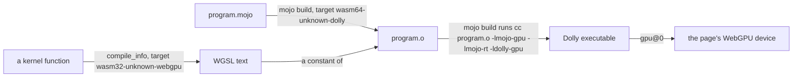

# Mojo programs in Dolly

What a Mojo program needs to run here, up to GPU kernels through
`DeviceContext`. The compiler itself is [the demo around this](../README.md).
Everything is against the tag `mojo/v1.1.0` of `github.com/modular/modular`.



## Key files

- [`patches/compiler.patch`](patches/compiler.patch): the two targets.
  `wasm64-unknown-dolly` is a program: an object for Dolly's linker, generated
  as `wasm64-unknown-emscripten`, the triple of Dolly's libc archives, as `cc`
  does. `wasm32-unknown-webgpu` is a kernel: its "assembly" is WGSL.
- [`patches/stdlib.patch`](patches/stdlib.patch): the standard library's
  bindings to Dolly's libc, and for WebGPU the kernel-side names
  (`thread_idx`, `block_idx`, `block_dim`, `grid_dim`, `global_idx`) and
  what a kernel prints.
- [`../Dollyfile-mojo-runtime`](../Dollyfile-mojo-runtime): `libmojo-rt.a`,
  the compiler runtime over libc, and `libmojo-gpu.a`, the device side of
  `DeviceContext` over `gpu@0`. Their sources are the recipe's `FILE` bodies.
- [`gpu/`](gpu): the Mojo package `gpu`: `gpu.host.DeviceContext`, the
  kernel-side names and `gpu.sync.barrier`. A program imports it with `-I`
  this directory.
- [`cross-compile.sh`](cross-compile.sh), [`test/`](test): the fixtures as
  objects, and their run in the `mojo-runtime` image.

## Build and test

In [the `mojo` image](../README.md) `mojo build program.mojo` does all of
it, and that image's test compiles these fixtures there. The test here
needs no compiler in Dolly: it takes its programs as objects from a native
compiler built from the patched source (45 minutes at six jobs, 10 GB):

```sh
mkdir -p build/mojo-target && cd build/mojo-target
git clone --depth 1 --branch mojo/v1.1.0 https://github.com/modular/modular
cd modular
patch -p1 < ../../../demos/mojo/target/patches/compiler.patch
patch -p1 < ../../../demos/mojo/target/patches/stdlib.patch
printf '%s\n' 'startup --output_user_root='"$PWD"'/../bazel-root' \
  'build --config=build-mojo --config=disable-mypy --disk_cache= --compilation_mode=opt' \
  'common --sandbox_base=' > local.bazelrc
./bazelw build //Mojo/tools/mojo:mojo
cd ../../..
demos/mojo/target/cross-compile.sh
npm run image -- mojo-runtime
node demos/mojo/target/test/mojo-target-browser.mjs
```

## A program

- The driver takes `--target-triple wasm64-unknown-dolly`, which the
  compiler built in Dolly has as its default; the CPU and the
  features are then those of every object `cc` makes, and Wasm tail calls,
  which coroutines need and every browser with 64-bit memories has.
  The driver links by running `cc ARCHIVE COMPILER-RT -lm`: in Dolly that is
  Dolly's `cc` with `libmojo-rt.a` as the CompilerRT; a native compiler has
  no such `cc`, so it stops at `--emit object`.
- `CompilationTarget.is_dolly()` is the standard library's name for the
  platform; it is neither `is_linux()` nor `is_macos()`. Files, paths,
  time, `subprocess.run` and `Process.run` work; Dolly has no FIFO, hard
  link or password database, and `dlopen` is not ported. Of the 261 programs
  of upstream's own test suite 224 do what upstream expects
  ([the task](../../../tasks/20261012-130814-mojo-programs/TASK.md) has the
  table).
- The runtime is one thread: a task runs when something waits for it, and
  `parallelism_level()` is 1. Nothing public in the standard library of this
  tag starts parallel work (`parallelize` is in `max`). Python
  interoperation is absent, so a program that uses it does not link.
- `mojo run`, the REPL and `mojo debug` execute through LLVM's JIT, which
  Wasm cannot have: code is a module the browser instantiates, not memory a
  process writes. In Dolly they fail saying so; `mojo build` and running the
  result is what there is.

## A kernel

```mojo
from gpu import global_idx
from gpu.host import DeviceContext

def saxpy(x: Pointer[Float32, MutAnyOrigin], y: Pointer[Float32, MutAnyOrigin],
          result: Pointer[Float32, MutAnyOrigin], a: Float32, n: Int):
    var i = global_idx.x
    if i < n:
        result[unsafe_offset=i] = a * x[unsafe_offset=i] + y[unsafe_offset=i]

ctx.enqueue_function[saxpy](x, y, result, Float32(2), n, grid_dim=4, block_dim=256)
```

Upstream's `DeviceContext` is the package `max` over CUDA, HIP and Metal
drivers that are not open source, so this one is new, with its names:
`enqueue_create_buffer`, `enqueue_function`, `synchronize`, and on a buffer
`enqueue_copy_from`, `enqueue_copy_to`, `enqueue_fill`, `map_to_host`.
Upstream's two GPU hellos (`gpu_hello.mojo` and `hello_writing.mojo` of its
documentation) run with `gpu.host` for `max.gpu.host` in their import; its
other examples index buffers through `layout`, which is in `max`.

- A kernel is compiled as 32-bit code, so its `Int` is 32 bits wide, like
  WGSL's integers; an `Int` argument that does not fit raises when enqueued.
- Each pointer parameter is a storage buffer and takes a `DeviceBuffer`; a
  pointer is an offset into the buffer its parameter names. The other
  parameters (integers, `Float32`, `Bool`) travel in one more buffer. A
  buffer is 32-bit words; one the kernel stores a `Bool`, 8 or 16 bits into
  has atomic words, so that four threads can store into one.
- `Atomic[T].fetch_add`, `max`, `min` and `compare_exchange` on a pointer
  into a buffer work for `UInt32`, `Int32` and `Float32`: WGSL's atomic
  where it has one, else a loop around its compare and exchange.
- `stack_allocation[N, T, address_space=AddressSpace.SHARED]()` is memory
  of the block's threads, and `barrier()` of `gpu.sync` waits until each of
  them has reached a barrier or returned. WGSL wants its barrier in uniform
  control flow, which a kernel's is not: a thread at a barrier leaves the
  loop of blocks, and all meet at one WGSL barrier. So a barrier may stand
  anywhere, also where only some threads come.
- `block_dim` is the WebGPU workgroup size, set when the pipeline is created:
  at most 256 threads on a default device. `grid_dim` is the workgroup
  count. A block the device does not admit raises when enqueued, as does a
  kernel with more buffers than it binds (10 where measured, the scalar
  arguments being one of them and what it prints another).
- Control flow is printed as a block number in a loop, so any branch or loop
  compiles; calls are inlined; a local array of a fixed size is a WGSL
  array, and a struct, an `Optional` or a tuple is its scalars. The text
  must fit `gpu@0`'s 128 KiB for a shader, or `enqueue_function` raises: a
  dozen math functions are 13 KB, and the largest of the fixtures is the
  one that prints, 42 KB.
- `print` in a kernel is formatted there and becomes a record of one more
  buffer, 64 KiB, which the runtime writes out once the kernel has run,
  thread after thread; `enqueue_function` then waits for it. A float is
  printed by the formatter upstream has for Apple's GPUs, to six decimals.
  A print of two floats and five integers is 90 KB of WGSL, which a GPU
  compiles in 3 to 7 seconds and software in 20.
- `Int64` and `UInt64` are two words each, in buffers, values and
  arguments: arithmetic, division a bit at a time, shifts, comparisons and
  conversions; no 64-bit atomic.
- The compiler refuses, naming the instruction: `Float64`, `Float16`, SIMD
  vectors, pointers stored in memory or chosen between two buffers,
  recursion, and the libm functions WGSL lacks (`log10`, `cbrt`, `expm1`,
  `erfc`, gamma and Bessel functions).
- Floating point is the device's. Where measured, an infinity or a NaN from
  a buffer, a sum or a division compares and propagates as on the host, a
  subnormal result is zero, a value times two constants whose product
  overflows was 0.0 on the NVIDIA driver and infinite in software, and a
  `UInt32` of more than 24 bits became the nearest `Float32` on the GPU and
  the next one up in software.
- A failed `assert` or an `abort` prints its message and ends that
  invocation; the others go on, since WGSL has no trap.
- WebGPU forbids one buffer bound twice as writable, so enqueueing a kernel
  with the same `DeviceBuffer` for two parameters raises.
- A failure of `gpu@0` raises with its errno's text; the page's GPU indicator
  has WebGPU's message.
