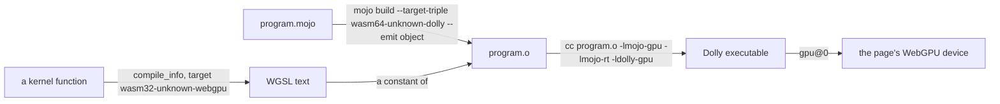

# Mojo programs in Dolly

What a Mojo program needs to run here, up to GPU kernels through
`DeviceContext`. The compiler itself is [the demo around this](../README.md).
Everything is against the tag `mojo/v1.1.0` of `github.com/modular/modular`.



## Key files

- [`patches/compiler.patch`](patches/compiler.patch): the two targets.
  `wasm64-unknown-dolly` is a program: an object for Dolly's linker, generated
  as `wasm64-unknown-emscripten`, the triple of Dolly's libc archives, as `cc`
  does. `wasm32-unknown-webgpu` is a kernel: its "assembly" is WGSL.
- [`patches/stdlib.patch`](patches/stdlib.patch): the standard library's
  bindings to Dolly's libc and the kernel-side names (`thread_idx`,
  `block_idx`, `block_dim`, `grid_dim`, `global_idx`) for WebGPU.
- [`../Dollyfile-mojo-runtime`](../Dollyfile-mojo-runtime): `libmojo-rt.a`,
  the compiler runtime over libc, and `libmojo-gpu.a`, the device side of
  `DeviceContext` over `gpu@0`. Their sources are the recipe's `FILE` bodies.
- [`gpu/`](gpu): the Mojo package `gpu`: `gpu.host.DeviceContext` and the
  kernel-side names. A program imports it with `-I` this directory.
- [`cross-compile.sh`](cross-compile.sh), [`test/`](test): the fixtures as
  objects, and their run in the `mojo-runtime` image.

## Build and test

There is no compiler in Dolly yet, so programs are cross-compiled by a native
compiler built from the patched source (45 minutes at six jobs, 10 GB):

```sh
mkdir -p build/mojo-target && cd build/mojo-target
git clone --depth 1 --branch mojo/v1.1.0 https://github.com/modular/modular
cd modular
patch -p1 < ../../../demos/mojo/target/patches/compiler.patch
patch -p1 < ../../../demos/mojo/target/patches/stdlib.patch
printf '%s\n' 'startup --output_user_root='"$PWD"'/../bazel-root' \
  'build --config=build-mojo --config=disable-mypy --disk_cache= --compilation_mode=opt' \
  'common --sandbox_base=' > local.bazelrc
./bazelw build //Mojo/tools/mojo:mojo
cd ../../..
demos/mojo/target/cross-compile.sh
npm run image -- mojo-runtime
node demos/mojo/target/test/mojo-target-browser.mjs
```

## A program

- The driver takes `--target-triple wasm64-unknown-dolly`; the CPU and the
  features are then those of every object `cc` makes, and Wasm tail calls,
  which coroutines need and every browser with 64-bit memories has.
  `--emit object` is what works; the driver's own link step runs `cc ARCHIVE
  COMPILER-RT -lm`, which Dolly's `cc` can serve once the compiler runs here
  with `libmojo-rt.a` as its CompilerRT.
- `CompilationTarget.is_dolly()` is the standard library's name for the
  platform; it is neither `is_linux()` nor `is_macos()`. Files, paths,
  time, `subprocess.run` and `Process.run` work; Dolly has no FIFO, hard
  link or password database, and `dlopen` is not ported. Of the 261 programs
  of upstream's own test suite 211 run as built
  ([the task](../../../tasks/20261012-130814-mojo-programs/TASK.md) has the
  table).
- The runtime is one thread: a task runs when something waits for it, and
  `parallelism_level()` is 1. Nothing public in the standard library of this
  tag starts parallel work (`parallelize` is in `max`). Python
  interoperation is absent, so a program that uses it does not link.
- `mojo run` and the REPL execute through LLVM's JIT, which Wasm cannot have:
  code is a module the browser instantiates, not memory a process writes. In
  Dolly `mojo run` is to be `mojo build` and a spawn of the result; the REPL
  and `mojo debug` are refused.

## A kernel

```mojo
from gpu import global_idx
from gpu.host import DeviceContext

def saxpy(x: Pointer[Float32, MutAnyOrigin], y: Pointer[Float32, MutAnyOrigin],
          result: Pointer[Float32, MutAnyOrigin], a: Float32, n: Int):
    var i = global_idx.x
    if i < n:
        result[unsafe_offset=i] = a * x[unsafe_offset=i] + y[unsafe_offset=i]

ctx.enqueue_function[saxpy](x, y, result, Float32(2), n, grid_dim=4, block_dim=256)
```

Upstream's `DeviceContext` is the package `max` over CUDA, HIP and Metal
drivers that are not open source, so this one is new, with its names:
`enqueue_create_buffer`, `enqueue_function`, `synchronize`, and on a buffer
`enqueue_copy_from`, `enqueue_copy_to`, `enqueue_fill`.

- A kernel is compiled as 32-bit code, so its `Int` is 32 bits wide, like
  WGSL's integers; an `Int` argument that does not fit raises when enqueued.
- Each pointer parameter is a storage buffer and takes a `DeviceBuffer`; a
  pointer is an offset into the buffer its parameter names. The other
  parameters (`Int`, `UInt`, `Int32`, `UInt32`, `Float32`, `Bool`) travel in
  one more buffer. A kernel loads 8, 16 and 32 bits and stores 32: storing
  less would rewrite the word around it, which another thread may be writing.
- `block_dim` is the WebGPU workgroup size, set when the pipeline is created:
  at most 256 threads on a default device, and a larger block raises when
  enqueued. `grid_dim` is the workgroup count.
- Control flow is printed as a block number in a loop, so any branch or loop
  compiles; calls are inlined. The text must fit `gpu@0`'s 128 KiB for a
  shader: the largest of the fixtures, eleven math functions, is 13 KB.
- The compiler refuses, naming the instruction: 64-bit integers, `Float64`,
  `Float16`, SIMD vectors, stores of 8 and 16 bits, pointers stored in memory
  or chosen between two buffers, recursion, `print`, and the libm functions
  WGSL lacks (`log10`, `cbrt`, `expm1`, `erfc`, gamma and Bessel functions).
- A failed `assert` or an abort ends that invocation without a message; the
  others go on. WGSL has no trap and `gpu@0` carries no kernel output.
- WebGPU forbids one buffer bound twice as writable, so enqueueing a kernel
  with the same `DeviceBuffer` for two parameters raises.
- A failure of `gpu@0` raises with its errno's text; the page's GPU indicator
  has WebGPU's message.
