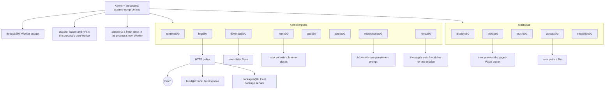

# Browser boundary

Assume every program, file and byte of Wasm userspace is compromised. Guest code
can then exercise only the authority of the trusted browser providers below.
This is the review map: keep it current when an import, host module or local
service changes.

Trusted: the browser engine, page and Worker JavaScript, and host-module
implementations. Outside the model: engine bugs, XSS, compromised application
JavaScript, and hosts that rewrite delivered HTML ([deployment](deployment.md)).
Private processes help recovery, not containment.

The page holds no view of kernel memory; only Workers do. A module's Worker
side reads and writes its mailboxes and sends the page copies of what it shows;
the page side keeps its DOM work and sends what the user does, and the display
paints from the runtime Worker into the page's canvas (an `OffscreenCanvas`).
So the page's code never reads memory the guest can change under it, and the
kernel's memory goes when its Workers end, not when the page's heap is next
collected ([`boundary-browser.mjs`](../test/boundary-browser.mjs) checks the heap).



## Host modules

[`abi/dolly-browser-0.wat`](../abi/dolly-browser-0.wat) is the exact outer import
allowlist: every import carries a Dolly name, the build rejects any other, and
artifact checks reject a kernel export that no contract names. The Worker
instantiates the kernel itself, with no generated JavaScript:
[`host/modules.mjs`](../host/modules.mjs) builds the whole import object, each
import from the module whose [manifest](../host/README.md) owns it; a disabled
module's imports return `ENOSYS`. Images and packets select no JavaScript or
Worker URL.

| Module | Channel | Authority | Code |
| --- | --- | --- | --- |
| `runtime@0` | `env.memory`, `env.dolly_memory_grow`, `env.dolly_clock_realtime`, `env.dolly_clock_monotonic`, `env.dolly_entropy`, `env.dolly_bootstrap_write_bytes`, terminal mailbox | Kernel memory, grown up to its maximum by a Worker of the module's own; the two clocks; 64 KiB of entropy a call; boot text, 1 MiB a write; process Workers, each holding its process's memory and a mailbox in kernel memory; report foreground and results, receive Ctrl+C | [`host/runtime/`](../host/runtime/module.json) ([`process-supervisor.mjs`](../src/process-supervisor.mjs)) |
| `http@0` | `env.dolly_http_dispatch`, 16-slot pool | The only agent-selected network edge, under the page's policy | [`host/http/`](../host/http/module.json) |
| `download@0` | `env.dolly_download_dispatch` | Stream one file (1 MiB chunks, 1 GiB) into a Blob under a checked basename; saved only by a user click; at most 4 waiting | [`host/download/`](../host/download/module.json) |
| `html@0` | `env.dolly_html_dispatch` | Show one document of at most 1 MiB of UTF-8 in a popup in boot()'s element, and return the fields of the form of it the user submits (64 KiB, as a form posts them) or that the user closed it. The popup is a sandboxed frame of an opaque origin (scripts and forms only, no popups, modals or top navigation) whose policy fetches nothing and runs only the page's script and style; that script builds the popup from the document's text and an allowlist of content and form elements and attributes, copied into new elements, so no URL, style, script, link, refresh or base of it exists there. The look is the embedding's (custom properties on boot()'s element; the page fetches the font file they name and hands the popup its bytes). One popup at a time; refused for 2 s after a close | [`host/html/`](../host/html/module.json) |
| `upload@0` | mailbox | Ask for a file; the user picks it; 1 GiB of bytes in 1 MiB chunks, no name or path; refused for 2 s after a cancel | [`host/upload/`](../host/upload/module.json) |
| `snapshot@0` | mailbox | Save and restore opaque session deltas (512 MiB) on user action | [`host/snapshot/`](../host/snapshot/module.json) |
| `display@0` | mailbox | Publish checked RGBA frames and a closed cursor value; read the surface's size; load the display plugin from WasmFS; the terminal's selection reaches the clipboard on the user's Ctrl+Shift+C | [`host/display/`](../host/display/module.json) ([`kernel-plugin.mjs`](../src/kernel-plugin.mjs)) |
| `input@0` | mailbox | Receive bounded records of keys, IME text, paste, window focus, pointer buttons and positions on the canvas, wheel; ask for pointer lock, granted only on a user's press on the canvas. On a touchscreen the page's Paste button reads the clipboard's text inside the user's press of it | [`host/input/`](../host/input/module.json) |
| `touch@0` | mailbox | Receive bounded records of fingers on the canvas (an id from down to up, position, pressure, time), ten at once and 512 queued, while the foreground program or a descendant holds the lease; then no finger is a pointer record of `input@0`. The holder may show up to 12 labels (31 bytes of text each) as buttons in the page's bar beside its Paste; a press is only a record to the holder, and Paste stays the page's own | [`host/touch/`](../host/touch/module.json) |
| `gpu@0` | `env.dolly_gpu_dispatch` | Bounded WebGPU packets on the browser's `high-performance` adapter, 8 scopes, 4,096 objects each, 4 GiB total, one canvas. With no adapter, nothing: `OPEN` fails with `ENODEV` | [`host/gpu/`](../host/gpu/module.json) |
| `audio@0` | `env.dolly_audio_dispatch` | Stereo PCM output, 4 streams of 1 s; no capture | [`host/audio/`](../host/audio/module.json) |
| `microphone@0` | `env.dolly_microphone_dispatch` | Mono PCM of the browser's default input: one capture, 2 s queued. The browser is asked only when a program opens it and grants it only through its own prompt; the page shows it while held; tracks stop on close and exit. No device list, labels or choice, no video | [`host/microphone/`](../host/microphone/module.json) |
| `nena@0` | `env.dolly_nena_dispatch` | List the page's modules and ask the page to enable or disable one for this session. A packet names a module of the fixed registry, never a URL, file or provider; a switch grants what the switched module's row says, and nothing of the page's policy or the browser's prompts changes | [`host/nena/`](../host/nena/module.json) |
| `threads@0` | supervisor | Worker per thread of an admitted executable: 32 per process, 64 total | [`host/threads/`](../host/threads/module.json) |
| `sockets@0` | none | Local stream sockets between processes of the kernel, in its memory: 128 sockets, 16 unaccepted connections a listener, 64 KiB a direction. No network family and nothing outside Wasm | [`host/sockets/`](../host/sockets/module.json) |
| `pty@0` | supervisor | Pseudo-terminals between processes of the kernel, in its memory: 32 of them, 4 KiB of input and 64 KiB of output each. The supervisor delivers the signals one raises. Nothing outside Wasm | [`host/pty/`](../host/pty/module.json) |
| `dso@0` | process Worker of an executable that records it, each thread's in a program using `threads@0` | Instantiate Wasm the process supplies into its own memory and function table, and call its table entries with signatures chosen at run time; no import, no kernel entry, nothing outside that process | [`host/dso/`](../host/dso/module.json) ([`process.mjs`](../host/dso/process.mjs)) |
| `stack@0` | process Worker of an executable that records it, each thread's in a program using `threads@0` | Call the program's own `dolly_stack_continue` on a fresh stack (`WebAssembly.promising`, through a trusted module of three functions that catches what it throws) and set its `dolly_stack_room` global; no import, no kernel entry, nothing outside that process | [`host/stack/`](../host/stack/module.json) ([`process.mjs`](../host/stack/process.mjs)) |
| `build@0` | reserved URL via `http@0` | Start a disposable image build that writes the image cache | [`host/build/`](../host/build/module.json) |
| `packages@0` | reserved URL via `http@0` | Serve the verified snapshot of a published package, one at a time, 64 per page | [`host/packages/`](../host/packages/module.json) |

- `REQUIRES HOST` lines and executable `dolly.host` records
  ([`dolly-host-0.wat`](../abi/dolly-host-0.wat)) are compatibility demands, not
  grants; a missing provider fails before ENTRY. An image's own recipe is its
  complete list: nothing is inherited from `FROM`, `INSTALL`, `USE` or `COPY` images,
  sealing refuses a retained executable stamped with an undeclared module, and
  the loader refuses one at run time. A module the embedding does not name
  (`boot()`'s `modules`) exists neither on the page nor in the Worker. A page
  of the site names its image's modules and what they depend on, and every
  module for a build, a custom image, a saved session or an image that
  declares `nena@0` ([`site.mjs`](../src/site.mjs)).
- `nena@0` is the one way a session's set changes after boot, and only an
  image that declares it has it (`default` does). Such a session enables and
  disables modules freely, by design: assume it can use every module of this
  table that is not fixed, each within its own bounds, the browser's
  permission prompts and the page's HTTP policy, none of which a switch
  touches. In any other image the provider does not exist: the import answers
  `ENOSYS`, the page handles no such request, and the set stays the recipe's
  list after total compromise of the userspace.
  - The page holds the set and makes each switch
    ([`modules.mjs`](../host/modules.mjs)), its own side first when enabling
    and last when disabling; the Worker's side follows by message. An enabled
    module starts as at boot, after its own `check()`, which the browser
    must answer within five seconds.
  - A disabled module is gone at once, for running processes too: its
    providers are disposed, its imports answer `ENOSYS`, and the loader
    refuses executables that record it at every launch, also ones it has
    compiled before. `threads@0` terminates its Workers and ends the programs
    that ran on them, each told why. What a module keeps
    in Wasm, such as local sockets, stays with the processes that hold it.
  - A module whose manifest says `fixed` is never switched: `runtime@0`,
    `http@0` (its policy is consumed once, at load), `build@0`, and
    `display@0`, `input@0` and `snapshot@0`, which the terminal and the
    session's baseline are built on before ENTRY; the modules others depend
    on are among them.
  - `nena disable nena` disposes the provider itself: nothing switches a
    module again until the page is reloaded.
  - The provider writes the modules a session enabled beyond its image's to
    `/etc/dolly/enabled` and enables what that file lists when the session is
    loaded. The file is the session's own; it is read only where the image
    declares `nena@0`, where the userspace decides anyway. A module the page
    cannot enable then is reported on the page and left out.
- The page enables exactly the image's requirements, its runtime among them;
  rebuild routes add `http@0`, `threads@0`, `dso@0` and `stack@0` for
  building (sources are fetched, and toolchains run threaded tools, compilers
  and interpreters that load modules, and tools `stack-wrap` rewrote), and a
  dependency build enables the declared runtime with those four. A build's loader also admits the
  modules of the images it reads, which it does not enable: their calls
  answer `ENOSYS`. Only Dollyfile Studio
  declares `build@0`, and the page admits it only after ENTRY starts
  ([Studio builds](image-build-service.md)). An image declaring `packages@0`
  (`default`) may GET `https://packages.dolly.invalid/v1/packages/SHA256`
  after ENTRY starts: the page serves a published package's snapshot, rebuilt
  and verified from the release's packs exactly as a build input
  ([`service.mjs`](../host/packages/service.mjs)). A pin outside the release is
  404, a second concurrent snapshot 409, the 65th per page 429; the bytes are
  ordinary sandbox data and grant nothing ([amy](dollyfile.md#packages-and-amy)).
  The index of package names is not the service's: it is the site's public
  `amy-index.txt`, an ordinary request under the HTTP policy.
- Builders ([`image-builder.mjs`](../src/image-builder.mjs)) run the build
  host's modules as the page's modules configure them (`host.builder`): the
  page's HTTP policy without local services, no display, file picker or
  ENTRY. One build runs per page; cancellation holds that lease until the
  builder stops.
- Build and custom-session policy comes from trusted browser state, never from
  recipe or snapshot contents. [`http.mjs`](../host/http/http.mjs) consumes the
  embedding's policy once and intersects a result tab's saved parent policy
  with its own; missing inheritance fails closed, so reopening a build cannot
  silently restore unrestricted HTTP. Build results are opaque retained files,
  not permission to execute host code.
- Audio and GPU scope, lease and object IDs are never reused and request
  sequences only increase, so a stale handle never reaches a successor. The
  browser tracks one outstanding request per slot: fabricated Wasm mailbox
  completions cannot bypass admission, and a revoked or cancelled slot stays
  occupied until the provider settles.

## Network

- Programs have no Fetch, network sockets, DNS or TLS. libcurl, Git, Python and
  Janis are adapters above `http@0` ([HTTP](http.md)). `sockets@0` connects
  processes inside the kernel only, for programs linked with it: no socket
  call reaches a network ([process model](process-model.md#local-sockets)).
- Policy is set by the embedding outside Wasm and survives total compromise.
  **The default permits arbitrary HTTP(S), including credentials stored in Dolly:
  it does not prevent exfiltration.** An allowlist bounds destinations, not what
  an allowed destination does with the data.
- The default includes the app's own origin (same-origin requests need no CORS).
  URLs must be absolute; the page URL is no implicit base. Restrict it with a policy.
- Bootstrap sources are the exact files the release publishes, named by their
  site paths; the page fetches the copy its own release holds
  ([`policy.mjs`](../host/http/policy.mjs)). The guest cannot choose where that
  copy is, and its address grants nothing. Other files of the site are
  ordinary destinations.
- A relay ([HTTP](http.md#cors-and-relays)) is embedding configuration consumed
  with the policy: it maps an exact origin to a URL prefix the page fetches
  instead. It adds no destination: the policy judges the URL the program
  asked for before the mapping applies, and the guest can neither set nor see
  it. It moves trust: the relay's operator sees every relayed request and
  chooses what is returned, so it receives no credential header the mapping
  does not name, and its requests follow no redirect. No relay is configured
  by default or on the public sites.
- Loopback and LAN hosts are ordinary destinations: responses need CORS, but the
  request itself still reaches them.
- A request URL that is a site path (`/vX.Y.Z/amy-index.txt`, the page's own
  version) is resolved against the root of the site serving the release,
  never above it, and then judged by the policy like any absolute URL
  ([`broker.mjs`](../host/http/broker.mjs)); another version's path is refused. It
  grants nothing: the default policy already admits the page's own origin, an
  explicit policy admits the file only by a rule for it, and the request
  carries no cookies. The program is told the path it asked for, not where
  the site is served.
- Reserved `*.dolly.invalid` URLs never reach Fetch; redirects cannot enter them
  and remote rules cannot grant them.
- The broker owns a fixed 16-slot provider table, independent of the guest's
  claimed free slots. Cancellation is acknowledged at once but holds the host
  slot until the provider settles, so forged slot state or repeated cancellation
  cannot grow a host queue. The kernel acknowledges records by compare-exchange,
  so a late acknowledgement cannot erase a terminal failure.
- Multipart reassembly ([`static-asset.mjs`](../src/static-asset.mjs)) applies
  only to exact bootstrap sources (every inherited policy must agree), pinned
  snapshot packs and user-clicked source links. The manifest holds sizes and
  hashes, never destinations; parts are fixed `.part-N` siblings fetched without
  guest headers, credentials, queries or redirects, within the original deadline
  and byte bound (parts of 20 MiB, at most the largest snapshot, 2 GiB). A remote
  response cannot activate it.

## Other crossings

| Channel | Bound |
| --- | --- |
| Keyboard, pointer, wheel, focus, paste (`input@0`) | Bounded records, one motion sample per animation frame; a record the ring has no room for is counted, shown and marked in the ring, never queued on the page ([input](input.md#the-ring)). Interpretation stays in Wasm. Nothing is read from the clipboard but a paste the user makes: the browser's own, or, on a touchscreen, a press of the page's Paste button. Pointer lock only after a trusted canvas press while the program holding the lease asks; Escape ends it. Without `input@0` no listener writes a record |
| Surface size (`display@0`) | Three numbers the page sends: width, height, device scale |
| Clipboard copy (`display@0`) | Bounded selection text after a user Ctrl+Shift+C |
| Page keys | F11 (fullscreen) and Ctrl+Shift+F (indicators) are the page's own and are taken before any module or the guest reads them ([`page-chords.mjs`](../src/page-chords.mjs)); the guest cannot request fullscreen |
| RGBA frames, bootstrap text | Visible output only; the browser parses no terminal content, and HTML only in `html@0`'s popup |
| Mailbox wake-ups | The kernel and the Worker's module sides notify each other on display, input and touch mailbox words (new frame, animation frame, input or touch record, lease); a notify carries no data, and a forged one only costs the guest's own time |
| GPU indicator | While the session has `gpu@0`, page text over the display naming the browser's adapter and whether it has `shader-f16`, or why there is none; no guest input ([`gpu.mjs`](../host/gpu/gpu.mjs)) |
| Indicator visibility | The GPU indicator, Save button and download offers hide ten seconds after the page is ready and on the user's `Ctrl+Shift+F`, which is not delivered as input. Page state shows them again (a new adapter state, a save, an offer); the one guest request among these is the bounded download offer, which shows them and can hide nothing ([`page-indicators.mjs`](../src/page-indicators.mjs)) |
| Image ending | Once the ENTRY process is gone, page text below the last frame says how it ended: its exit status or signal number, or one line of its failure (printable ASCII, 512 bytes; the stack goes to the console). The page sets it as text and parses none of it; a running program can draw a lookalike but cannot cover, change or remove the notice. A module may add a link it builds itself, as `snapshot@0` does for the session the tab saved ([`browser.mjs`](../src/browser.mjs)) |
| Image cache | Verified artifacts: each image's snapshot a file of origin-private storage, indexed in IndexedDB, 32 images and 8 GiB ([`image-artifact.mjs`](../src/image-artifact.mjs)) |
| Pack store | The packs of the images this browser has read, so a start or a saved session reads none of them again: each a file of origin-private storage named by its SHA-256, kept only once its reader has checked it against that digest, checked so again at every use and removed when it fails. Each image read records its packs; when no image is being read on the origin (a Web Lock), the records of another runtime's images and of images the catalog no longer has go, then every pack no record names. Only the page and its Workers write it, from trusted metadata: a program that installs a package (`packages@0`) or builds an image (`build@0`) makes it keep that image's packs, bytes of the catalog and nothing else. The sessions page shows its size and clears it. A save asks the browser to keep the origin's storage (`navigator.storage.persist()`) ([`pack-store.mjs`](../src/pack-store.mjs)) |
| Boot and code loading | Fixed kernel artifacts only ([`worker-image.mjs`](../src/worker-image.mjs)): the kernel and, for a root build, the compiler seed, a snapshot the kernel restores itself; one bundled process Worker; the plugin loader links an explicit kernel export map and fetches nothing |
| Process entry | The supervisor measures, with a recursion of its own, whether `WebAssembly.promising` gives a stack half again as deep; where it does, the process Worker calls through it the entry of an executable that carries a `dolly.process.stack` section (the compiler alone), only for that stack ([browser stack](browser-stack.md)). No import is `Suspending`, so the call still runs to completion before the Worker handles anything else ([`process-supervisor.mjs`](../src/process-supervisor.mjs), [`process-worker.mjs`](../src/process-worker.mjs)) |
| Clocks, entropy, CPU and memory use | Inputs and availability effects only; the kernel grows its own memory up to its declared maximum, and its abort is a Wasm trap |

## Trusted files

Beside the host modules (each one's directory, named by its manifest), these
are the trusted files a page and its runtime Worker load; a process Worker
loads the bundle of [`process-worker.mjs`](../src/process-worker.mjs) and the
modules it serves. An image directory's catalog (`dist/dolly-images.mjs`) and
image metadata (`dist/dolly-IMAGE-system-snapshot.mjs`) are modules its build
writes, which the page and the Worker import: the embedding trusts the image
directory it names as it trusts the runtime, whose build writes the build
identities and ABI constants they import (`dist/dolly-build-id.mjs`,
`dist/dolly-image-build-id.mjs`, `dist/dolly-process-abi.mjs`). The rest of what a page fetches is
data checked against them: packs, recipes and sources.

| Part | Files |
| --- | --- |
| Page | [`browser.mjs`](../src/browser.mjs) (`boot()`), [`site.mjs`](../src/site.mjs) (the site's routes), [`source-download.mjs`](../src/source-download.mjs) (the site's source links), [`terminal-text.mjs`](../src/terminal-text.mjs), [`build-log.mjs`](../src/build-log.mjs), [`page-chords.mjs`](../src/page-chords.mjs), [`page-indicators.mjs`](../src/page-indicators.mjs), [`coi-serviceworker.js`](../coi-serviceworker.js) (isolation where a host sends no headers) |
| Registry | [`modules.mjs`](../host/modules.mjs), [`manifests.mjs`](../host/manifests.mjs) (the site's list), [`requirements.mjs`](../host/requirements.mjs), [`abi.mjs`](../host/abi.mjs) |
| Images | [`images.mjs`](../src/images.mjs), [`packaged-snapshot.mjs`](../src/packaged-snapshot.mjs), [`pack-store.mjs`](../src/pack-store.mjs), [`image-inputs.mjs`](../src/image-inputs.mjs), [`snapshot-records.mjs`](../src/snapshot-records.mjs), [`image-entry.mjs`](../src/image-entry.mjs), [`image-names.mjs`](../src/image-names.mjs), [`static-asset.mjs`](../src/static-asset.mjs), [`sha256.mjs`](../src/sha256.mjs), [`version.mjs`](../src/version.mjs) |
| Runtime Worker | [`worker-image.mjs`](../src/worker-image.mjs), [`runtime-worker.mjs`](../src/runtime-worker.mjs) (boot()'s), [`build-worker.mjs`](../src/build-worker.mjs) (the site's and `dolly-build`'s), [`process-supervisor.mjs`](../src/process-supervisor.mjs), [`kernel-plugin.mjs`](../src/kernel-plugin.mjs), [`process-abi.mjs`](../src/process-abi.mjs), [`wasm-interface.mjs`](../src/wasm-interface.mjs), [`process-constants.mjs`](../src/process-constants.mjs) |
| Building images (the site's, and `dolly-build`'s page for npm users) and custom images (the site's) | [`image-build.mjs`](../src/image-build.mjs), [`image-builder.mjs`](../src/image-builder.mjs), [`image-artifact.mjs`](../src/image-artifact.mjs), [`custom-image.mjs`](../src/custom-image.mjs), [`custom-dollyfile.mjs`](../src/custom-dollyfile.mjs) (the custom image page), [`dollyfile-view.mjs`](../src/dollyfile-view.mjs), [`dollyfile-graph.mjs`](../src/dollyfile-graph.mjs) |
| Sessions | [`session-store.mjs`](../src/session-store.mjs), [`session-file.mjs`](../src/session-file.mjs), [`sessions.mjs`](../src/sessions.mjs) (the site's list), [`alphabetical.mjs`](../src/alphabetical.mjs) |

## The page's handle

Once an image's page is `ready`, `window.__dolly` drives and reads it: for a
script in the page, an agent's browser or a test. The tests, release
acceptance and the checks of a deployed site use it.

- `submit(command)` types the line and Enter and resolves to the status the
  shell publishes when it has run; `input(text)`, `paste(text)` and
  `key(key, code, modifiers)` type as the keyboard and the paste chord do
  (`input@0`).
- `visibleTerminalText()` returns the screen's text, by selecting every cell
  and reading the selection; `waitForInteractiveTerminal(pattern)` waits for
  a program in raw mode whose screen matches.
- `terminal` (the result's sequence, the foreground, `interruptForeground()`,
  which is Ctrl+C), `foregroundPid`, `hostModules` (the session's modules) and
  `builtImage` (the identity of the image a rebuild built: its SHA-256, size and
  inputs). What the handle reads of the
  terminal (its foreground, grid, geometry, the leases) is what the Worker last
  reported; what it asks (a result, the selection) resolves later.
- An enabled module adds its own and takes them away when `nena` disables it:
  `transport`, `fontSize`, `graphicsActive`, `copySelection()`, `frame()` (`display@0`),
  `inputTransport` (`input@0`), `touchTransport` (`touch@0`), the broker's request counters (`http@0`),
  `sessionName` and `saveSession(name)` (`snapshot@0`), `gpu`, `audio` and
  `microphone`.

None gives authority a user of the page lacks: each write is what a key, a
paste, a click or Save does, through the same functions, without the gesture.
Wasm cannot reach the handle. A process can publish any status, so the one
`submit` resolves to is the shell's word, not a proof.

## Persistence

- Unsaved state dies with the tab. Compromise can persist in a saved session, an
  exported session file or a custom image; discard them when trust is lost.
- Sessions and exports may contain credentials; they are neither encrypted nor
  signed. Browser storage is per origin: every site on one `github.io` account
  can read Dolly's sessions, image cache and pack store, and write them: a
  pack is checked against the digest the image's metadata names at every use. Dolly's own versions on an origin
  keep their saves apart by database name, which separates them for the user
  and is no boundary between them ([sessions](sessions.md)).
- Images never retain `/tmp` or `/workspace`, and otherwise only the paths their
  recipes name. A hash proves byte identity, not that an image is benign.

## Required checks

- Exact typed outer imports; no automatic allowance for new port requirements.
- Denied HTTP never reaches Fetch; credentials, redirects, limits and
  cancellation stay enforceable after arbitrary guest mailbox writes.
- Span, frame, input, file-transfer and decompression bounds fail closed.
- Filesystem and process operations stay in Wasm, local sockets and pseudo-terminals among them;
  unsupported fork, network socket and host operations fail without fallbacks.
- Fixed loaders cannot resolve guest-selected URLs, paths or JavaScript.
- Process failure and forced termination preserve the kernel and shell.
- An image without `nena@0` cannot change its modules; with it, a fixed module
  stays fixed and a disabled one answers nothing.

These are testable design invariants, not a formal containment proof. Worker
termination and resource bounds help availability but do not protect against
browser-wide memory pressure or engine failure.

```sh
node scripts/dolly-abi.mjs validate-browser build/dolly-browser-0.wasm dist/dolly.wasm
node --test test/http-broker.test.mjs test/http-policy.test.mjs test/host-modules.test.mjs
```

Treat any new import, mailbox, host module or local service as an authority
change: review it here and prove denial in a real browser.
