# Browser boundary

Assume every program, file and byte of Wasm userspace is compromised. Guest code
can then exercise only the authority of the trusted browser providers below.
This is the review map: keep it current when an import, host module or local
service changes.

Trusted: the browser engine, page and Worker JavaScript, and host-module
implementations. Outside the model: engine bugs, XSS, compromised application
JavaScript, and hosts that rewrite delivered HTML ([deployment](deployment.md)).
Private processes help recovery, not containment.

The page holds no view of kernel memory; only Workers do. A module's Worker
side reads and writes its mailboxes and sends the page copies of what it shows;
the page side keeps its DOM work and sends what the user does, and the display
paints from the runtime Worker into the page's canvas (an `OffscreenCanvas`).
So the page's code never reads memory the guest can change under it, and the
kernel's memory goes when its Workers end, not when the page's heap is next
collected ([`boundary-browser.mjs`](../test/boundary-browser.mjs) checks the heap).

```mermaid
flowchart TB
  guest["Kernel + processes: assume compromised"]
  subgraph imports["Kernel imports"]
    rt["runtime@0"]
    http["http@0"]
    dl["download@0"]
    html["html@0"]
    gpu["gpu@0"]
    au["audio@0"]
    mic["microphone@0"]
    nena["nena@0"]
  end
  subgraph mailboxes["Mailboxes"]
    disp["display@0"]
    inp["input@0"]
    tch["touch@0"]
    clip["clipboard@0"]
    up["upload@0"]
    snap["snapshot@0"]
    pkg
  end
  th["threads@0: Worker budget"]
  dso["dso@0: loader and FFI in the process's own Worker"]
  stack["stack@0: a fresh stack in the process's own Worker"]
  guest --> imports
  guest --> mailboxes
  guest --> th
  guest --> dso
  guest --> stack
  http --> policy["the page's HTTP policy"]
  pkg["packages@0: another directory's files"] --> policy
  policy --> fetch(("Fetch"))
  http --> build["build@0: local build service"]
  dl --> save["user clicks Save"]
  html --> answer["user submits a form or closes"]
  up --> picker["user picks a file"]
  mic --> prompt["browser's own permission prompt"]
  inp --> paste["user presses the page's Paste button"]
  clip --> copy["user's key press or click moments before"]
  nena --> set["the page's set of modules for this session"]
```



## Host modules

[`abi/dolly-browser-0.wat`](../abi/dolly-browser-0.wat) is the exact outer import
allowlist: every import carries a Dolly name, the build rejects any other, and
artifact checks reject a kernel export that no contract names. The Worker
instantiates the kernel itself, with no generated JavaScript:
[`host/modules.mjs`](../host/modules.mjs) builds the whole import object, each
import from the module whose [manifest](../host/README.md) owns it; a disabled
module's imports return `ENOSYS`. Images and packets select no JavaScript or
Worker URL. What each module's JavaScript calls of the browser (and the page's
and the site's) is a table of [`browser-apis.test.mjs`](../test/browser-apis.test.mjs),
which fails on a call outside its row: a change there is a change of the
Authority column here, and the two go together.

| Module | Channel | Authority | Code |
| --- | --- | --- | --- |
| `runtime@0` | `env.memory`, `env.dolly_memory_grow`, `env.dolly_clock_realtime`, `env.dolly_clock_monotonic`, `env.dolly_entropy`, `env.dolly_bootstrap_write_bytes`, `env.dolly_build_input_read`, terminal mailbox | Kernel memory, grown up to its maximum by a Worker of the module's own; the two clocks; 64 KiB of entropy a call; boot text, 1 MiB a write; in a build, the bytes of the images and files the page handed it as its inputs, 8 MiB a read, which the kernel reads as files instead of holding them; process Workers, one a thread for threads@0, each holding its process's memory and a mailbox in kernel memory, which the page makes at the runtime Worker's or threads@0's request, only from a `blob:` URL (the bundled process Worker, a module holder, packages@0's Worker, a blob that imports its file); report foreground and results, receive Ctrl+C | [`host/runtime/`](../host/runtime/module.json) ([`process-supervisor.mjs`](../page/process-supervisor.mjs)) |
| `http@0` | `env.dolly_http_dispatch`, 16-slot pool | The only agent-selected network edge, under the page's policy | [`host/http/`](../host/http/module.json) |
| `download@0` | `env.dolly_download_dispatch` | Stream one file (1 MiB chunks, 1 GiB) into a Blob under a checked basename; saved only by a user click; at most 4 waiting | [`host/download/`](../host/download/module.json) |
| `html@0` | `env.dolly_html_dispatch` | Show one document of at most 1 MiB of UTF-8 in a popup in boot()'s element, and return the fields of the form of it the user submits (64 KiB, as a form posts them) or that the user closed it. The popup is a sandboxed srcdoc frame in which no script runs (forms only, no scripts, popups, modals or top navigation; of the page's origin, so the page writes into it): the page parses the document with DOMParser, which loads and runs nothing, and builds the popup from its text and an allowlist of content and form elements and attributes, copied into new elements, so no URL, style, script, link, refresh or base of it exists there. A form's submit event reaches the page, which takes its fields and stops the submission. The browser offers none of the user's saved addresses, cards or past entries in its fields (each form `autocomplete="off"`, each control a token the browsers do not fill). The frame holds no script or style element, so it needs nothing of the embedding's Content-Security-Policy, which a srcdoc frame takes. The look is the embedding's (custom properties on boot()'s element; the page fetches the font file they name and hands the popup its bytes). One popup at a time; refused for 2 s after a close | [`host/html/`](../host/html/module.json) |
| `upload@0` | mailbox | Ask for a file; the user picks it; 1 GiB of bytes in 1 MiB chunks, no name or path; refused for 2 s after a cancel | [`host/upload/`](../host/upload/module.json) |
| `snapshot@0` | mailbox | Save and restore an opaque copy of the whole filesystem but `/dev`, `/proc` and `/run` (8 GiB) on user action | [`host/snapshot/`](../host/snapshot/module.json) |
| `display@0` | mailbox | Publish checked RGBA frames and a closed cursor value; read the surface's size and the page's colours; load the display plugin from WasmFS; the terminal's selection reaches the clipboard on the user's Ctrl+Shift+C | [`host/display/`](../host/display/module.json) ([`kernel-plugin.mjs`](../page/kernel-plugin.mjs)) |
| `input@0` | mailbox | Receive bounded records of keys, IME text, paste, window focus, pointer buttons and positions on the canvas, wheel; ask for pointer lock, granted only on a user's press on the canvas. On a touchscreen the page's Paste button reads the clipboard's text inside the user's press of it | [`host/input/`](../host/input/module.json) |
| `touch@0` | mailbox | Receive bounded records of fingers on the canvas (an id from down to up, position, pressure, time), ten at once and 512 queued, while the foreground program or a descendant holds the lease; then no finger is a pointer record of `input@0`. The holder may show up to 12 labels (31 bytes of text each) as buttons in the page's bar beside its Paste; a press is only a record to the holder, and Paste stays the page's own | [`host/touch/`](../host/touch/module.json) |
| `clipboard@0` | mailbox | Write at most 256 KiB of UTF-8 text to the browser's clipboard, only while the page has the focus and the user's activation (`navigator.userActivation.isActive`: a key press or click on the page moments before, as the copy's own key or menu click is), and only by the program holding the clipboard, the foreground command or its descendant. Read nothing from the browser: the text of a paste the user makes into the page (input@0's) is written into the clipboard, and reaches a program holding it and the input lease as the paste chord's keys | [`host/clipboard/`](../host/clipboard/module.json) |
| `gpu@0` | `env.dolly_gpu_dispatch` | Bounded WebGPU packets on the browser's `high-performance` adapter, 8 scopes, 65,536 objects each, 4 GiB total, one canvas, which the runtime Worker's animation frames pace. With no adapter, nothing: `OPEN` fails with `ENODEV` | [`host/gpu/`](../host/gpu/module.json) |
| `audio@0` | `env.dolly_audio_dispatch` | Stereo PCM output, 4 streams of 1 s; no capture | [`host/audio/`](../host/audio/module.json) |
| `microphone@0` | `env.dolly_microphone_dispatch` | Mono PCM of the browser's default input: one capture, 2 s queued. The browser is asked only when a program opens it and grants it only through its own prompt; the page shows it while held; tracks stop on close and exit. No device list, labels or choice, no video | [`host/microphone/`](../host/microphone/module.json) |
| `nena@0` | `env.dolly_nena_dispatch` | List the page's modules and ask the page to enable or disable one for this session. A packet names a module of the fixed registry, never a URL, file or provider; a switch grants what the switched module's row says, and nothing of the page's policy or the browser's prompts changes | [`host/nena/`](../host/nena/module.json) |
| `threads@0` | supervisor | Worker per thread of an admitted executable, which the page makes through runtime@0's relay: 32 per process, 64 total | [`host/threads/`](../host/threads/module.json) |
| `sockets@0` | none | Local stream sockets between processes of the kernel, in its memory: 128 sockets, 16 unaccepted connections a listener, 64 KiB a direction. No network family and nothing outside Wasm | [`host/sockets/`](../host/sockets/module.json) |
| `pty@0` | supervisor | Pseudo-terminals between processes of the kernel, in its memory: 32 of them, 4 KiB of input and 64 KiB of output each. The supervisor delivers the signals one raises. Nothing outside Wasm | [`host/pty/`](../host/pty/module.json) |
| `console@0` | kernel exports, from the runtime Worker | The standard streams of a root process the page names: a terminal, a pseudo-terminal whose master the page holds, which it types into, reads, sizes and hangs up; or three pipes, whose input the page writes and ends and whose output and error it reads. A program gets nothing more | [`host/console/`](../host/console/module.json) |
| `dso@0` | process Worker of an executable that records it, each thread's in a program using `threads@0` | Instantiate Wasm the process supplies into its own memory and function table (each thread's, in the order of the records in that memory), call its table entries with signatures chosen at run time, and wait on a word of its memory (libc's futex in a threaded host); no import, no kernel entry, nothing outside that process | [`host/dso/`](../host/dso/module.json) ([`process.mjs`](../host/dso/process.mjs)) |
| `stack@0` | process Worker of an executable that records it, each thread's in a program using `threads@0` | Call the program's own `dolly_stack_continue` on a fresh stack (`WebAssembly.promising`, through a trusted module of three functions that catches what it throws) and set its `dolly_stack_room` global; no import, no kernel entry, nothing outside that process | [`host/stack/`](../host/stack/module.json) ([`process.mjs`](../host/stack/process.mjs)) |
| `build@0` | reserved URL via `http@0` | Start a disposable image build that writes the image cache | [`host/build/`](../host/build/module.json) |
| `packages@0` | mailbox | Hand over an image directory's URL, its `amy-index.txt` (one chunk) and the verified snapshot of a package it publishes, 2 GiB in 1 MiB chunks into a file of the guest's that must not exist: the page's own directory, or another the guest names, each of whose files is read only where the page's HTTP policy admits it and none kept; one process at a time, another's request waiting until that process ends; 1024 snapshots per page load, past which the page says a reload gives more | [`host/packages/`](../host/packages/module.json) |

- `REQUIRES HOST` lines and executable `dolly.host` records
  ([`dolly-host-0.wat`](../abi/dolly-host-0.wat)) are compatibility demands, not
  grants; a missing provider fails before ENTRY. An image's own recipe is its
  complete list: nothing is inherited from `FROM`, `INSTALL`, `USE` or `COPY` images,
  sealing refuses a retained executable stamped with an undeclared module, and
  the loader refuses one at run time. A module the embedding does not name
  (`boot()`'s `modules`) exists neither on the page nor in the Worker. A page
  of the site names its image's modules and what they depend on, and every
  module for a build, a custom image, a saved session or an image that
  declares `nena@0` ([`site.mjs`](../site/site.mjs)).
- `nena@0` is the one way a session's set changes after boot, and only an
  image that declares it has it (`default` does). Such a session enables and
  disables modules freely, by design: assume it can use every module of this
  table that is not fixed, each within its own bounds, the browser's
  permission prompts and the page's HTTP policy, none of which a switch
  touches. The page's status line says each switch, and a microphone a
  session enabled itself captures only after the user allows it on the page,
  once a session: the browser's own prompt is per origin and remembered. In
  any other image the provider does not exist: the import answers
  `ENOSYS`, the page handles no such request, and the set stays the recipe's
  list after total compromise of the userspace.
  - The page holds the set and makes each switch
    ([`modules.mjs`](../host/modules.mjs)), its own side first when enabling
    and last when disabling; the Worker's side follows by message. An enabled
    module starts as at boot, after its own `check()`, which the browser
    must answer within five seconds.
  - A disabled module is gone at once, for running processes too: its
    providers are disposed, its imports answer `ENOSYS`, and the loader
    refuses executables that record it at every launch, also ones it has
    compiled before. `threads@0` terminates its Workers and ends the programs
    that ran on them, each told why. What a module keeps
    in Wasm, such as local sockets, stays with the processes that hold it.
  - A module whose manifest says `fixed` is never switched: `runtime@0`,
    `build@0`, and `display@0`, `input@0` and `snapshot@0`, which the
    terminal and a restored session are built on before ENTRY. Nor is one
    that an enabled module depends on disabled (`http@0` under `build@0`).
    `http@0` takes the page's policy as it was at load, and enabling it
    widens nothing that policy does not admit; disabling it ends each
    transfer in flight with `ECANCELED`.
  - `nena disable nena` disposes the provider itself: nothing switches a
    module again until the page is reloaded.
  - The provider writes the modules a session enabled beyond its image's to
    `/etc/dolly/enabled` and enables what that file lists when the session is
    loaded. The file is the session's own; it is read only where the image
    declares `nena@0`, where the userspace decides anyway. A module the page
    cannot enable then is reported on the page and left out.
- The page enables exactly the image's requirements, its runtime among them;
  rebuild routes add `http@0`, `threads@0`, `dso@0` and `stack@0` for
  building (a step may fetch, and toolchains run threaded tools, compilers
  and interpreters that load modules, and tools `stack-wrap` rewrote), and a
  dependency build enables the declared runtime with those four. The engine
  fetches nothing: the build Worker hands it the root recipe's text and each
  `SOURCE` row's file as build inputs, the image directory's own files read
  by their sizes in its catalog and an external URL fetched by the page under
  its HTTP policy (`network-fetch`, [`network.mjs`](../page/network.mjs),
  [`build-worker.mjs`](../site/build-worker.mjs)); the engine checks each
  file's SHA-256. A build's loader also admits the
  modules of the images it reads, which it does not enable: their calls
  answer `ENOSYS`. Only Dollyfile Studio
  declares `build@0`, and the page admits it only after ENTRY starts
  ([Studio builds](image-build-service.md)). An image declaring `packages@0`
  (`default`) gets an image directory's URL, its `amy-index.txt` and a
  published package's snapshot, rebuilt and verified from its packs exactly
  as a build input, over the module's mailbox
  ([`dolly-packages-0.wat`](../host/packages/dolly-packages-0.wat),
  [`transport.mjs`](../host/packages/transport.mjs)): the kernel writes them
  into a file of the guest's that must not exist, as upload@0 does. Of a
  directory the guest names (`amy server URL`) the package Worker
  ([`worker.mjs`](../host/packages/worker.mjs)) reads each file (the index,
  the catalog, every metadata file, pack and pack part) as the broker reads
  the guest's: only where the page's HTTP policy, its image's `HTTP` rows
  included, admits a GET of that URL, counted and shown as the guest's request (`admit`,
  [`network.mjs`](../page/network.mjs)), without credentials, within the
  rule's `maxResponseBytes` and timeout; a refusal ends the request with
  `EACCES`, and none of its packs is kept in the pack store. Only metadata
  for this runtime passes. A pin the directory does not publish is `ENOENT`,
  the 1025th snapshot of a page load `EDQUOT`; the bytes are ordinary sandbox
  data and grant nothing ([amy](dollyfile.md#packages-and-amy)).
- Builders ([`image-builder.mjs`](../site/image-builder.mjs)) run the build
  host's modules with the page network's `builder()`: the page's HTTP policy
  and its count, without local services, display, file picker or ENTRY. One build runs per page; cancellation holds that lease until the
  builder stops. `build@0` builds with the one the site's routes give the
  page (`imageBuilder`, [`site.mjs`](../site/site.mjs)); a page without one
  has no `build@0`.
- Build and custom-session policy comes from trusted browser state, never from
  snapshot contents or anything the guest wrote. The page ([`network.mjs`](../page/network.mjs))
  takes the embedding's policy once and intersects a result tab's saved parent
  policy with its own; missing inheritance fails closed, so reopening a build cannot
  silently restore unrestricted HTTP. An image's recipe can only narrow it
  (its `HTTP` rows, [Network](#network)). Build results are opaque retained files,
  not permission to execute host code.
- Audio and GPU scope, lease and object IDs are never reused and request
  sequences only increase, so a stale handle never reaches a successor. The
  browser tracks one outstanding request per slot: fabricated Wasm mailbox
  completions cannot bypass admission, and a revoked or cancelled slot stays
  occupied until the provider settles.

## Network

- Programs have no Fetch, network sockets, DNS or TLS. libcurl, Git, Python and
  Janis are adapters above `http@0` ([HTTP](http.md)). `sockets@0` connects
  processes inside the kernel only, for programs linked with it: no socket
  call reaches a network ([process model](process-model.md#local-sockets)).
- Policy is set by the embedding outside Wasm and survives total compromise.
  **The default permits arbitrary HTTP(S), including credentials stored in Dolly:
  it does not prevent exfiltration.** An allowlist bounds destinations, not what
  an allowed destination does with the data.
- The default includes the app's own origin (same-origin requests need no CORS).
  A URL is absolute or a site path (below); the page URL is no implicit base.
  Restrict it with a policy.
- An image narrows the page's policy with the requests its recipe declares,
  its `HTTP` rows ([Dollyfile](dollyfile.md#the-images-network)). The page
  intersects them with the embedding's policy and any inherited one, so they
  never widen it, and reads them from the recipe's text only: the catalog's
  record of the image (its `httpPolicy`, written from the recipe by the
  catalog's build or `dolly-build`) or a custom image's recipe, which the page
  keeps for its tab and its saves ([`browser.mjs`](../page/browser.mjs),
  [`site.mjs`](../site/site.mjs)). Every page that runs the image applies them
  to all it fetches for the guest, a restored session and a build in that page
  included, and a tab opened from it inherits them. A package declares none,
  so `amy install` changes nothing. `dolly-build` gives an image without rows
  a policy of no rule.
- A build's inputs (the recipes and `SOURCE` files of the image directory)
  never pass the broker: the build Worker reads them by the sizes the catalog
  gives and the engine checks each by its SHA-256. A `SOURCE` row's URL is
  fetched by the page as a GET a module makes for the guest: admitted and
  counted by the policy, without credentials, within its rule
  ([`network.mjs`](../page/network.mjs) `fetch`). A file of the site is an
  ordinary destination of the policy ([`http-policy.mjs`](../page/http-policy.mjs)),
  for a build step as for any program.
- A relay ([HTTP](http.md#cors-and-relays)) is embedding configuration consumed
  with the policy: it maps an exact origin to a URL prefix the page fetches
  instead. It adds no destination: the policy judges the URL the program
  asked for before the mapping applies, and the guest can neither set nor see
  it. It moves trust: the relay's operator sees every relayed request and
  chooses what is returned, so it receives no credential header the mapping
  does not name, and its requests follow no redirect. No relay is configured
  by default or on the public sites.
- Loopback and LAN hosts are ordinary destinations: responses need CORS, but the
  request itself still reaches them.
- A request URL that is a site path (`/amy-index.txt`) is resolved against
  the root of the site serving the release, never above it, and then judged
  by the policy like any absolute URL
  ([`broker.mjs`](../host/http/broker.mjs)). It
  grants nothing: the default policy already admits the page's own origin, an
  explicit policy admits the file only by a rule for it, and the request
  carries no cookies. The program is told the path it asked for, not where
  the site is served.
- Reserved `*.dolly.invalid` URLs never reach Fetch; redirects cannot enter them
  and remote rules cannot grant them.
- The broker owns a fixed 16-slot provider table, independent of the guest's
  claimed free slots. Cancellation is acknowledged at once but holds the host
  slot until the provider settles, so forged slot state or repeated cancellation
  cannot grow a host queue. The kernel acknowledges records by compare-exchange,
  so a late acknowledgement cannot erase a terminal failure.
- A transfer holds its slot while it waits, so the policy's timeout bounds each
  wait: for the response's headers, its next bytes, or the guest reading the
  record before. A server that stops and a reader that never reads both free
  the slot a timeout later. A transfer that keeps moving has no total limit; it
  carries out only the body admission judged whole, and brings in at most
  `maxResponseBytes`.
- Multipart reassembly ([`static-asset.mjs`](../page/static-asset.mjs)) applies
  only to a build's inputs of the image directory, pinned snapshot packs and
  user-clicked source links, never to a program's request. The manifest holds sizes and
  hashes, never destinations; parts are fixed `.part-N` siblings fetched without
  guest headers, credentials, queries or redirects, under the original timeout
  and byte bound (parts of 20 MiB, at most the largest snapshot, 2 GiB). A remote
  response cannot activate it.

## Other crossings

| Channel | Bound |
| --- | --- |
| Keyboard, pointer, wheel, focus, paste (`input@0`) | Bounded records, at most two motion samples per animation frame; a record the ring has no room for is counted, shown and marked in the ring, never queued on the page ([input](input.md#the-ring)). Interpretation stays in Wasm. Nothing is read from the clipboard but a paste the user makes: the browser's own, or, on a touchscreen, a press of the page's Paste button. Pointer lock only after a trusted canvas press while the program holding the lease asks; Escape ends it. Without `input@0` no listener writes a record |
| Surface size (`display@0`) | Three numbers the page sends: width, height, device scale |
| Clipboard copy (`display@0`) | Bounded selection text after a user Ctrl+Shift+C |
| Clipboard copy (`clipboard@0`) | Bounded text a program copied, written by the page only under the user's activation and focus ([input](input.md#clipboard)) |
| Page keys | F11 (fullscreen) and Ctrl+Shift+F (indicators) are the page's own and are taken before any module or the guest reads them ([`page-chords.mjs`](../page/page-chords.mjs)); the guest cannot request fullscreen |
| RGBA frames, bootstrap text | Visible output only; the browser parses no terminal content, and HTML only in `html@0`'s popup |
| Mailbox wake-ups | The kernel and the Worker's module sides notify each other on display, input and touch mailbox words (new frame, animation frame, input or touch record, lease); a notify carries no data, and a forged one only costs the guest's own time |
| GPU indicator | While the session has `gpu@0`, page text over the display naming the browser's adapter and whether it has `shader-f16`, or why there is none; no guest input ([`gpu.mjs`](../host/gpu/gpu.mjs)) |
| Indicator visibility | The GPU indicator and download offers hide ten seconds after the page is ready and on the user's `Ctrl+Shift+F`, which is not delivered as input. Page state shows them again (a new adapter state, an offer); the one guest request among these is the bounded download offer, which shows them and can hide nothing ([`page-indicators.mjs`](../page/page-indicators.mjs)) |
| Image ending | Once the ENTRY process is gone, page text below the last frame says how it ended: its exit status or signal number, or one line of its failure (printable ASCII, 512 bytes; the stack goes to the console). The page sets it as text and parses none of it; a running program can draw a lookalike but cannot cover, change or remove the notice. A module may add a link it builds itself, as `snapshot@0` does for the session the tab saved ([`browser.mjs`](../page/browser.mjs)) |
| Image cache | Verified artifacts: each image's snapshot a file of origin-private storage, indexed in IndexedDB, 32 images and 8 GiB ([`image-artifact.mjs`](../site/image-artifact.mjs)) |
| Pack store | The packs of the images this browser has read, so a start or a saved session reads none of them again: each a file of origin-private storage named by its SHA-256, kept only once its reader has checked it against that digest, checked so again at every use and removed when it fails. Each image read records its packs; when no image is being read on the origin (a Web Lock), the records of another runtime's images and of images the catalog no longer has go, then every pack no record names. A build's inputs that the image cache holds lose their records once the build has read them, so an image is kept once, decoded, and a start of it downloads its packs again. Only the page and its Workers write it, from trusted metadata: a program that installs a package (`packages@0`) or builds an image (`build@0`) makes it keep that image's packs, bytes of the catalog and nothing else. The sessions page shows its size and clears it. A save asks the browser to keep the origin's storage (`navigator.storage.persist()`) ([`pack-store.mjs`](../page/pack-store.mjs)) |
| Kept runtime | The site's own files that open a saved session (its session and sessions pages, the page's and the Workers' code, the host modules, the kernel; no image and nothing of a session), in the browser's Cache Storage, so a save opens when the network fails. The page writes it when a session is saved or imported, from the site's list `dist/dolly-offline.json`, each file checked against the SHA-256 the list gives; the cache is named by the site's address and the list's digest, and one of another list is removed. The site's service worker answers a same-origin GET from it only when the request itself fails, never in place of a response of the server, and controls only pages loaded after it. It holds no policy, adds no destination and reads nothing of the guest: a program reaches it only as it reaches the site's files, through `http@0`'s policy. The sessions page says whether it is kept and clears it with the pack store ([`offline.mjs`](../host/snapshot/offline.mjs), [`coi-serviceworker.js`](../coi-serviceworker.js)) |
| Boot and code loading | Fixed kernel artifacts only ([`worker-image.mjs`](../page/worker-image.mjs)): the kernel and, for a root build, the compiler seed, a snapshot the kernel restores itself; one bundled process Worker; the plugin loader links an explicit kernel export map and fetches nothing |
| Process entry | The supervisor measures, with a recursion of its own, whether `WebAssembly.promising` gives a stack half again as deep; where it does, the process Worker calls through it the entry of an executable that carries a `dolly.process.stack` section (the compiler and Emacs), only for that stack ([browser stack](browser-stack.md)). No import is `Suspending`, so the call still runs to completion before the Worker handles anything else ([`process-supervisor.mjs`](../page/process-supervisor.mjs), [`process-worker.mjs`](../page/process-worker.mjs)) |
| Clocks, entropy, CPU and memory use | Inputs and availability effects only; the kernel grows its own memory up to its declared maximum, and its abort is a Wasm trap |

## Trusted files

Beside the host modules (each one's directory, named by its manifest), these
are the trusted files a page and its runtime Worker load: `boot()`'s in `page/`,
the site's own in `site/`, with the build
identities and ABI constants the runtime's build writes (`dist/dolly-build-id.mjs`,
`dist/dolly-image-build-id.mjs`, `dist/dolly-process-abi.mjs`, `dist/dolly-kernel-plugin-abi.mjs`, which
[`generated.mjs`](../page/generated.mjs) alone imports; `dist/dolly-build-id.json` is the same identities as data); a process Worker
loads the bundle of [`process-worker.mjs`](../page/process-worker.mjs) and the
modules it serves. An image directory is data: the page and the Worker import its catalog
(`dist/dolly-images.json`) and image metadata
(`dist/dolly-IMAGE-system-snapshot.json`) as JSON (the package Worker fetches
another directory's, as above), and check its packs, recipes
and sources against them. A page runs none of its code, so an embedding may
boot a directory it does not trust: its programs get only the host modules the
embedding lists.

| Part | Files |
| --- | --- |
| Page | [`browser.mjs`](../page/browser.mjs) (`boot()`), [`route.mjs`](../site/route.mjs) (a route page: its image, module list and HTTP policy), [`site.mjs`](../site/site.mjs) (the site's routes), [`source-download.mjs`](../site/source-download.mjs) (the site's source links), [`network.mjs`](../page/network.mjs) (the page's HTTP policy, [`http-policy.mjs`](../page/http-policy.mjs), and its refusal notices, [`http-refusals.mjs`](../page/http-refusals.mjs)), [`terminal-text.mjs`](../page/terminal-text.mjs), [`build-log.mjs`](../page/build-log.mjs), [`page-chords.mjs`](../page/page-chords.mjs), [`page-indicators.mjs`](../page/page-indicators.mjs), [`coi-serviceworker.js`](../coi-serviceworker.js) (isolation where a host sends no headers; the kept runtime where the network fails) |
| Registry | [`modules.mjs`](../host/modules.mjs), [`manifests.mjs`](../host/manifests.mjs) (the site's list), [`requirements.mjs`](../host/requirements.mjs), [`abi.mjs`](../host/abi.mjs) |
| Images | [`images.mjs`](../page/images.mjs), [`packaged-snapshot.mjs`](../page/packaged-snapshot.mjs), [`pack-store.mjs`](../page/pack-store.mjs), [`image-inputs.mjs`](../page/image-inputs.mjs), [`snapshot-records.mjs`](../page/snapshot-records.mjs), [`image-entry.mjs`](../page/image-entry.mjs), [`image-names.mjs`](../page/image-names.mjs), [`static-asset.mjs`](../page/static-asset.mjs), [`sha256.mjs`](../page/sha256.mjs), [`version.mjs`](../page/version.mjs) |
| Runtime Worker | [`worker-image.mjs`](../page/worker-image.mjs), [`runtime-worker.mjs`](../page/runtime-worker.mjs) (boot()'s, bundled with what it imports into `dist/dolly-runtime-worker.mjs`), [`build-worker.mjs`](../site/build-worker.mjs) (the site's and `dolly-build`'s), [`process-supervisor.mjs`](../page/process-supervisor.mjs), [`kernel-plugin.mjs`](../page/kernel-plugin.mjs), [`process-abi.mjs`](../page/process-abi.mjs), [`wasm-interface.mjs`](../page/wasm-interface.mjs), [`process-constants.mjs`](../page/process-constants.mjs) |
| Building images (the site's, and `dolly-build`'s page for npm users) and custom images (the site's) | [`image-build.mjs`](../site/image-build.mjs), [`image-builder.mjs`](../site/image-builder.mjs), [`image-artifact.mjs`](../site/image-artifact.mjs), [`custom-image.mjs`](../site/custom-image.mjs), [`custom-dollyfile.mjs`](../site/custom-dollyfile.mjs) (the custom image page), [`dollyfile-view.mjs`](../site/dollyfile-view.mjs), [`dollyfile-graph.mjs`](../site/dollyfile-graph.mjs) |
| Sessions | `snapshot@0`'s [`session-store.mjs`](../host/snapshot/session-store.mjs) (the saves) and [`offline.mjs`](../host/snapshot/offline.mjs) (the kept runtime), [`session-file.mjs`](../site/session-file.mjs), [`sessions.mjs`](../site/sessions.mjs) (the site's list), [`alphabetical.mjs`](../site/alphabetical.mjs) |

## The page's handle

Once an image's page is `ready`, `window.__dolly` drives and reads it: for a
script in the page, an agent's browser or a test. The tests, release
acceptance and the checks of a deployed site use it.

- `submit(command)` types the line and Enter and resolves to the status the
  shell publishes when it has run; `input(text)`, `paste(text)` and
  `key(key, code, modifiers)` type as the keyboard and the paste chord do
  (`input@0`).
- `visibleTerminalText()` returns the screen's text, by selecting every cell
  and reading the selection; `waitForInteractiveTerminal(pattern)` waits for
  a program in raw mode whose screen matches.
- `terminal` (the result's sequence, the foreground, `interruptForeground()`,
  which is Ctrl+C), `foregroundPid`, `hostModules` (the session's modules) and
  `builtImage` (the identity of the image a rebuild built: its SHA-256, size and
  inputs). What the handle reads of the
  terminal (its foreground, grid, geometry, the leases) is what the Worker last
  reported; what it asks (a result, the selection) resolves later.
- An enabled module adds its own and takes them away when `nena` disables it:
  `transport`, `fontSize`, `graphicsActive`, `copySelection()`, `frame()` (`display@0`),
  `inputTransport` (`input@0`), `touchTransport` (`touch@0`), the broker's request counters (`http@0`),
  `sessionName` and `saveSession(name)` (`snapshot@0`), `gpu`, `audio`,
  `microphone`, and `openConsole({ argv })` (`console@0`), which starts the
  program `argv` names on a console the caller holds, as a command line could.

None gives authority a user of the page lacks: each write is what a key, a
paste, a click or `Ctrl+Shift+S` does, through the same functions, without the gesture.
Wasm cannot reach the handle. A process can publish any status, so the one
`submit` resolves to is the shell's word, not a proof.

## Persistence

- Unsaved state dies with the tab. Compromise can persist in a saved session, an
  exported session file or a custom image; discard them when trust is lost.
- Sessions and exports may contain credentials; they are neither encrypted nor
  signed. Browser storage is per origin: every page on Dolly's origin can read
  its sessions, image cache, pack store and kept runtime, and write them: a pack is checked
  against the digest the image's metadata names at every use. Dolly's own versions on an origin
  keep their saves apart by database name, which separates them for the user
  and is no boundary between them ([sessions](sessions.md)).
- Images never retain `/tmp`, and otherwise only the paths their
  recipes name. A hash proves byte identity, not that an image is benign.

## Required checks

- Exact typed outer imports; no automatic allowance for new port requirements.
- Denied HTTP never reaches Fetch; credentials, redirects, limits and
  cancellation stay enforceable after arbitrary guest mailbox writes. An
  image's `HTTP` rows narrow the page's policy and never widen it.
- Span, frame, input, file-transfer and decompression bounds fail closed.
- Filesystem and process operations stay in Wasm, local sockets and pseudo-terminals among them;
  unsupported fork, network socket and host operations fail without fallbacks.
- Fixed loaders cannot resolve guest-selected URLs, paths or JavaScript.
- Process failure and forced termination preserve the kernel and shell.
- An image without `nena@0` cannot change its modules; with it, a fixed module
  stays fixed and a disabled one answers nothing.

These are testable design invariants, not a formal containment proof. Worker
termination and resource bounds help availability but do not protect against
browser-wide memory pressure or engine failure.

```sh
node scripts/dolly-abi.mjs validate-browser build/dolly-browser-0.wasm dist/dolly.wasm
node --test test/http-broker.test.mjs test/http-policy.test.mjs test/host-modules.test.mjs
```

Treat any new import, mailbox, host module or local service as an authority
change: review it here and prove denial in a real browser.
