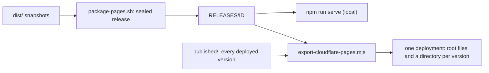

# Deployment

Dolly deploys as static files: no server code, Functions or proxy. A release is
a version `X.Y.Z` ([`version.mjs`](../page/version.mjs), the one line that
holds it): the git tag `vX.Y.Z`, the GitHub release of that name, the npm
packages' version and the site's directory `/vX.Y.Z/`. No recipe or image
holds the version, so moving it rebuilds no image: a release builds what its
own changes changed. The Cloudflare Pages project `dolly` keeps every
published version and serves one deployment at both of its domains,
[slopshare.dev](https://slopshare.dev/) and daugasauron.com.



## What a site serves

| Path on slopshare.dev | Response |
| --- | --- |
| `/`, `/llms.txt` | 302 to the newest version and to its `llms.txt` (`_redirects`) |
| `/vX.Y.Z/PATH` | That version's file at its checkout path: pages, code, recipes, sources, packs |
| `/robots.txt` | The newest version's `llms.txt` as comments, and a rule per version |
| `/404.html` | The newest version's |
| Anything else | 404 |

- Versions share nothing: each is its sealed release, file for file, under its
  path, so a published version keeps serving its own bytes whatever is
  released later. A reference a recipe writes, `/Dollyfile-NAME` or
  `/dist/static/…`, is a file of the version whose page reads it (Cloudflare
  holds a file over 25 MiB compressed or as parts, below).
  While the version is 0.x a patch release fixes and a minor release may
  change anything; nothing is promised about services outside the site (npm,
  model endpoints, git hosts) or about browsers.
- A published version never changes. A fix is a new version, and `/` then
  leads to it. Removing a version is the owner's explicit act: delete its
  directory from the archive and deploy; its paths return 404.
- One addition is allowed: a version is first deployed without its
  `/agents/` showcase or the menu's link to it, which a later deployment of
  the same version adds, so that its recordings can show the published site.
  That deployment adds the showcase's files, which were never served at those
  paths, and the link on the version's page (`index.html`, a page, never
  cached), and changes no other file of the version but the release's own
  lists (`deployment.sha256`, `release/`), which only the release scripts
  read; the exporter refuses any other change. The tag `vX.Y.Z` names the
  commit of the first deployment, the version's `release/source.commit` the
  showcase's.
- Saved sessions belong to a version; the image cache and the pack store are
  shared, and a version's page removes the packs no image of its runtime
  names ([sessions](sessions.md)).
- [`llms.txt`](../llms.txt) is the one text that says what the site is and
  how to use it, for a person or an agent that fetches it first. Every
  version carries it, its links relative to itself, so it is true wherever
  the version is mounted. A crawler asks for `robots.txt` only at a host's
  root, so the exporter writes it there
  ([`release-layout.mjs`](../scripts/release-layout.mjs)): the newest
  version's text as comments, its links as that version's paths, and
  `Disallow: /vX.Y.Z/dist/` once per published version. A rule per version is
  an exact prefix: every crawler reads it, and unlike a wildcard it cannot
  match a page. `dist/` holds the bulk: packs, sources and the runtime.

## Package and export

Use one catalog for source preparation, snapshots and packaging:

```sh
export DOLLY_BUILD_IMAGES="$(paste -sd, config/domain-pages-images.txt)"
npm run image
bash scripts/package-pages.sh build/domain-releases
npm run serve build/domain-releases     # the candidate as it will be deployed
```

- The catalog: [`domain-pages-images.txt`](../config/domain-pages-images.txt);
  dependencies are included automatically.
- The second packaging argument, `slopshare.dev`, adds the `/agents/` showcase
  and the menu's link to it ([`package-domain.mjs`](../scripts/package-domain.mjs)),
  for the version's later deployment. Its videos and posters are in git,
  `sites/slopshare.dev/agents/`: a new recording goes there with its section,
  each file within Pages' 25 MiB (`test/site-release.test.mjs`).
- [`package-pages.sh`](../scripts/package-pages.sh) `RELEASES SITE` seals a
  release into `RELEASES/ID` and points `RELEASES/current` at it (default
  `build/releases`). It generates the catalog's pages, registry and package
  index in the release; the checkout's stay as its last image build left them.
  [`site-release.mjs`](../scripts/site-release.mjs) `accept` verifies the
  staged site once, accepts its images in Chrome four side by side and seals
  the bytes it verified; `publish` and the exporter check files against that
  seal, and `verify` checks the whole release again (the checklist's gate). A
  sealed release carries its version and the commit it was packaged from.
- `RELEASES` must be on the checkout's filesystem: the release's packs and
  `dist/static/` sources are hard links to `dist/`'s, which nothing writes in
  place. A pack `dist/packs/` already holds, from an image build or an earlier
  packaging, is linked rather than compressed again; a new one is written
  there once.
- `npm run serve [RELEASES]` serves that directory's current release as it
  will be deployed: `/` redirects to its version, the site is under
  `/vX.Y.Z/`, every other path is 404.
- [`export-cloudflare-pages.mjs`](../scripts/export-cloudflare-pages.mjs)
  `ARCHIVE OUT RELEASE` assembles the deployment: every version in the
  archive, the new one exported from its sealed release, and the root files.
  A release of a version the archive holds takes its place when it only adds
  the showcase. Without `RELEASE` it assembles the archive alone, which is how
  a removed version leaves the site.
- The exporter checks each file against the seal as it reads it, refuses an
  existing destination, publishes atomically and uploads nothing. A file it
  stores whole is a hard link to the release's, and a part or compressed file
  a published version holds is a link to that one. A version's directory
  carries its seal: `sha256sum --check release/files.sha256` checks the
  release, and `deployment.sha256` what Cloudflare stores.
- A release needs disk for little more than the catalog in `dist/`: packaging
  0.1.7's catalog again added 0.1 GB of packs to `dist/packs/` and 0.76 GB of
  copied checkout files (pages, docs, metadata, the showcase's videos), and
  its export 85 MB; the rest are links. Sharing the catalog into packs streams
  one 4 MiB chunk at a time; verifying 0.1.7's release (`accept`, `verify`)
  held 11 GB resident, its export 4.4 GB.

## The archive of published versions

- `published/` in the checkout a release is made from (ignored by git) holds
  one directory per published version, exactly as it was deployed, with its
  `deployment.sha256` (every file) and `deployment.headers` (the headers its
  compressed and split files need). Every deployment needs all of them: the
  exporter checks each against its list and hard-links it into the new
  deployment, so the archive and `OUT` must be on one filesystem.
- The archive is the only record of what is published: a deployment assembled
  without a version removes that version from the site.
- The live site is the second copy.
  [`published-version.mjs`](../scripts/published-version.mjs)
  `mirror SITE vX.Y.Z ARCHIVE` takes a version back, checking every file
  against the list the site serves; compare that list's SHA-256 with the one
  in the version's release notes.
- Cloudflare Pages takes 20,000 files, 25 MiB each, and 100 `_headers` rules.
  The exporter fails at either limit, naming the versions; nothing is dropped
  automatically. When a new version does not fit, the oldest versions leave the
  site first, one at a time until it fits (owner, 2026-11-07): the release moves
  each from `published/` to `retired/` beside it, which keeps what was served,
  and its notes say which versions left (the sessions saved on them no longer
  open). A version needs a rule for each file it stores compressed; a page
  knows a file in parts by its manifest's content. One rule covers a file in
  every version that stores it the same way, so rules grow with distinct
  compressed files and with files whose storage changed, not with versions.
- 0.1.7's export of v0.1.5 to v0.1.7 is 15,092 files and 16 rules: the
  exporter's own 10 and 6 for compressed files all three store alike.

## Release

[`release-checklist.sh`](../scripts/release-checklist.sh)
`RELEASES [ARCHIVE]` checks steps 1 to 3, assembles the deployment of step 6
and boots it, then prints the commands of the others, which work as printed.
It never tags, pushes, publishes, uploads or deploys.

1. A green round on the commit: [`round.sh`](../scripts/round.sh) (the runtime,
   every image until its pins hold, the seeds' compilers a fixed point, lint,
   the source, artifacts and browser suites in both browsers, every demo, and
   the GPU tests on a display with a hardware adapter), whose verdict is its
   stages' exit statuses (`round.sh verdict`); the tree clean; every version
   the site serves (its `robots.txt`) in the archive, or retired beside it.
2. No credential in the commits to push or in `dist/dolly-*-system.snapshot`;
   an image may ship an upstream's public test key, listed by its PEM block's
   SHA-256 in `config/public-test-keys.txt`.
3. The site packaged from that commit, without its showcase, and accepted;
   the npm packages ([embedding](embedding.md)) packed from it, the tarballs
   to publish, boot from an empty app (`DOLLY_NPM_PACKS`, `test/npm-browser.mjs`;
   its log beside them).
4. Tag `vX.Y.Z` on the commit; push `main` and the tag.
5. GitHub release `vX.Y.Z` with notes and the seeds it was built with, the C
   compiler and the Rust and Go demos', each pinned to its asset
   ([sources](sources.md#the-seeds-compiler)), and the release then holds each
   one's pinned bytes;
   [`publish-npm.sh`](../scripts/publish-npm.sh) publishes each package of
   step 3 under `@daugasauron` in dependency order, signing in and approving
   in a browser, and checks that the registry holds the tested bytes.
6. Assemble the deployment from the archive and the new release; boot every
   version from it, served by [`pages-host.mjs`](../test/pages-host.mjs), in
   Chromium and Firefox (`published-version.mjs boot DEPLOYMENT vX.Y.Z…`);
   upload it with `wrangler pages deploy`, the account and its token in
   `CLOUDFLARE_ACCOUNT_ID` and `CLOUDFLARE_API_TOKEN`, where nothing
   interrupts it. An interrupted upload keeps nothing: never restart it.
7. Live at both domains, in Chromium and Firefox: `published-version.mjs boot SITE vX.Y.Z…`
   (`/` leads to the newest version, an unversioned path is 404, every
   version boots `default` from its own files) and
   `published-version.mjs verify SITE OUT vX.Y.Z` (every file of the new
   version, and every older version's list).
8. Move the new version's directory from `OUT` into the archive.

The showcase follows, its recordings made on the published version and
committed to `sites/slopshare.dev/agents/`: `package-pages.sh RELEASES
slopshare.dev`, then `release-checklist.sh --showcase RELEASES [ARCHIVE]`,
which checks that the commits since the tag change the showcase alone and
assembles the deployment in which the version adds it; its printed steps 6 to
8 deploy it, check its new files live (`verify SITE OUT vX.Y.Z ARCHIVE`: the
files of the earlier deployment are not fetched again), put it in the archive
in place of the first and push `main`. Then `DOLLY_VERSION` in
`page/version.mjs` moves to the next version.

## Delivery contract

| Path under `/vX.Y.Z/` | Caching on slopshare.dev |
| --- | --- |
| A page: the version's root and every address ending in `/` | No-store |
| Every file: code, recipes, sources, `dist/packs/HASH.snapshot.gz` | Immutable |

- A version's directory is its release: there is no path level for the
  release ID, which is the SHA-256 of `release/files.sha256`. Files are
  immutable because a published version never changes; pages are not, so a
  removed version stops loading. `npm run serve` sends no-store for
  everything, since a candidate keeps its version while it changes.
- Every URL is a file at its checkout path below the version (directories
  serve `index.html`; [`generate-routes.mjs`](../scripts/generate-routes.mjs)
  writes the menu, image routes and recipe views), so no host needs rewrite
  rules. Unknown paths get a `404.html` with status 404; missing assets must
  never get an HTML success response.
- Send `Cross-Origin-Opener-Policy: same-origin`,
  `Cross-Origin-Embedder-Policy: require-corp` and
  `Cross-Origin-Resource-Policy: same-origin` where possible; otherwise
  [`coi-serviceworker.js`](../coi-serviceworker.js) isolates same-origin
  responses below its version and passes cross-origin broker requests through
  unchanged. The same worker answers from the runtime a saved session
  keeps when a request fails ([sessions](sessions.md)); packaging writes that
  runtime's list, `dist/dolly-offline.json`
  ([`offline-files.mjs`](../scripts/offline-files.mjs)).
- Send the site's `Content-Security-Policy` (`siteContentSecurityPolicy` in
  [`serve.mjs`](../scripts/serve.mjs)): the strict policy of
  [embedding](embedding.md) with inline styles and every destination, as the
  site's default HTTP policy admits any. The exporter and the release server send
  it, and release acceptance boots each route under it with no violation.
- Snapshot `.gz` files are application payloads: never mark them
  `Content-Encoding: gzip`.
- The Cloudflare exporter splits oversized sources, packs and the compiler seed
  `dist/dolly.data` into verified 20 MiB parts, listed by a manifest at the
  file's path that the page knows by its first bytes
  ([`static-asset.mjs`](../page/static-asset.mjs)), and Brotli-compresses large
  downloads as `application/octet-stream`: the tested Pages runtime overwrites
  the encoding of Wasm MIME types. Do not substitute Workers Static Assets; its
  tested encoding behavior differs. Runtime JavaScript and Wasm are never
  precompressed or split.
- Disable CDN HTML rewriting, email obfuscation and injected analytics; they
  change the reviewed page. Serve Dolly from its own origin when sessions matter:
  storage is shared by every site on an origin.
- Verify delivered hashes and requests, not dashboard settings. Never put
  credentials in build artifacts or edit source while sealing.
- Docs publish every git-tracked text file they link outside `demos/`
  ([`package-documentation.mjs`](../scripts/package-documentation.mjs)).
