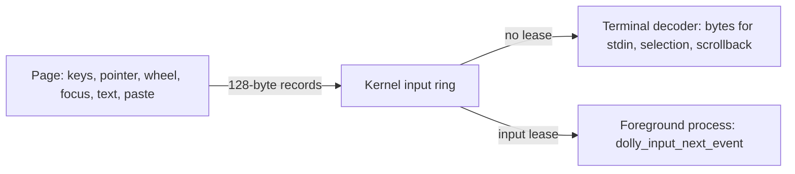

# Input

Keys, the pointer, the wheel, window focus, IME text and paste reach Wasm as
bounded records in one ring ([`host/input/dolly-input-0.wat`](../host/input/dolly-input-0.wat),
[`input.h`](../host/input/input.h), [`input.mjs`](../host/input/input.mjs)).
The page copies ordinary DOM event data and sends it to the runtime Worker,
which writes the records; what a record means is decided in Wasm. An image gets records only if it declares `REQUIRES HOST input@0`.

## Who reads the ring

- Without a lease the terminal does. Keys, text and paste go through the
  decoder that the display library registered
  ([display](display.md#terminal)) and become the bytes the foreground program
  reads from its terminal. Pointer and scroll records are the terminal's,
  handled ahead of unread keys on the display's tick: reports for a program
  that asked for the mouse, else selection and scrollback
  ([display](display.md#terminal)). The page sends the primary button, every
  move of the pointer and the wheel, and while the terminal shows the arrow,
  a program asking for the mouse, the middle and secondary buttons too: the
  browser's menu and the middle button's actions then give way, unless
  Shift is held. Other buttons reach only a program holding the lease. A finger's drag is sent as scroll records at the
  finger's position, so it scrolls where a mouse's drag selects.
  Two fingers moving apart or together are sent as the keys Ctrl+= and
  Ctrl+-, a font size for each 20 CSS px.
- A touchscreen has no paste chord. There the page shows its own Paste
  button, in its bar below the terminal: it reads the clipboard only inside
  the user's press of it and delivers the text as a paste, to the terminal or
  to a program holding the lease.
- `dolly_input_acquire` gives the foreground process or a descendant the
  lease, one at a time. It then reads every record with
  `dolly_input_next_event`, and the terminal reads none. The page sends it
  every button, pointer presence and a paste as text records.
- Release, exit or forced termination ends the lease; records the program had
  not read are dropped. So are the unread keys of a foreground program that
  ends without a lease, while the terminal keeps its pointer and scroll
  records.
- The display and input leases are independent
  ([graphics processes](display.md#graphics-processes)).
- Pointer lock: `dolly_input_set_pointer_relative` asks for relative motion.
  The page captures the pointer only on a user's press on the canvas while the
  lessee asks, and ends the capture on Escape, release or exit.

## The ring

- The ring in Wasm memory is the only queue of input; neither the page nor
  the Worker holds a record back. Pointer motion is a sample: relative deltas
  add up and the newest position wins. The page sends it once per animation
  frame, and the Worker writes it while half the ring is free, so it never
  takes a key's slot and a program that does not read delays it without
  losing it.
- Any other record needs a free slot. One that finds none is lost: the Worker
  counts it and writes one `DROPPED` record into the slot it keeps for that,
  where the first lost record would have been, and the page shows the count in
  `data-input-dropped` on `<html>` and in its status line. A program that reads
  it lets go of the keys and buttons it holds: a release may be among the lost.
- The Worker notifies the kernel's readers of each record one waits on (all
  under a lease; keys, text, paste and focus for the terminal), so the reader
  resumes then, not at the next 16 ms tick.

## Touch

`touch@0` gives a program the fingers on a touchscreen: every finger that is
down, each with an id from its down to its up or cancel, and buttons of its
own on the page
([`host/touch/dolly-touch-0.wat`](../host/touch/dolly-touch-0.wat),
[`touch.h`](../host/touch/touch.h), [`touch.mjs`](../host/touch/touch.mjs)).
What fingers mean, a tap, a drag or two of them moving apart, is the
program's to decide.

- A record is one finger at one moment: its id, its phase (down, move, up,
  cancel), its position in the frame's pixels as a pointer record's, the
  browser's pressure in thousandths and the event's time in milliseconds. At
  most ten fingers are down at once.
- `dolly_touch_acquire` gives the foreground process or a descendant the
  lease, one at a time, as for input. `dolly_touch_read` returns up to 64
  records and waits for the first. While a program holds the lease every
  finger that goes down on the canvas is its record and none is the pointer,
  also for a program holding the input lease; a finger already down stays the
  pointer's until it lifts. Without a holder a finger scrolls the terminal and
  two change its font, as above.
- The ring holds 512 records and is the only queue. The Worker writes every
  move the browser reports, coalesced ones included, while more than 20
  records are free, and a down only while the ring keeps room for it and the
  end of every finger that is down: a delivered finger's up or cancel is never
  lost. What is not written, a move without room, an eleventh finger or one
  whose down found no room, is counted in the next record's `dropped`.
- `dolly_touch_buttons` shows up to 12 labels as the holder's buttons in the
  page's bar below the terminal, before Paste, drawn as Paste is; each call
  replaces the ones before. A press of one is a record of phase `PRESS` whose
  id is the button's index. A press of buttons the holder has since replaced
  is not read, and the buttons go with the lease.
- A program at the terminal gets the terminal's frame and finds a cell by
  the cell size the terminal reports (`CSI 16 t`). The terminal's padding,
  12 by 10 CSS pixels, is not reported: a cell found so is the finger's or
  the one right of or below it.
- Release, exit or forced termination ends the lease; unread records are
  dropped. `nena` may switch the module; a holder's read then returns
  `ENOSYS`.
- C SDK: `<dolly/touch.h>` and `libdolly-touch.a`, from the `libdolly-touch`
  package; calling it stamps `touch@0` into the executable.

## Images without one of the two

- `display@0` without `input@0`: the terminal shows output and reads no key,
  a program that links the input client is refused before it runs, and the
  lease itself is `ENOSYS` wherever no page listens, a build included.
- `input@0` without `display@0`: a program that takes the lease reads keys,
  text, focus and paste. There is no canvas, so no pointer records, and no
  decoder, so a terminal read returns nothing and unread records stay queued.
