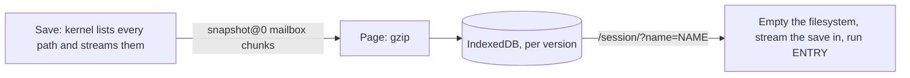

# Sessions and file transfer

A session is a named, browser-local save of the whole filesystem of a tab, but
`/dev`, `/proc` and `/run`. It does not save processes. A restore boots from the
save alone: the image is not loaded again. `upload` and `download` move single
files between the user's computer and WasmFS, one user action at a time.

## Save and load

- **Save** or `Ctrl+Shift+S` stores a checkpoint named with 1–64 of
  `A-Z a-z 0-9 . _ -` (not `.` or `..`). `/sessions/` lists saves with Rename,
  Export, Import, Delete and Recover files; `/session/?name=NAME` loads one.
- A tab asks before its save replaces one stored since it opened or last
  saved the session, another tab's.
- A reload opens the last save. A tab of the site whose session was saved or
  restored asks first, with the browser's own prompt, when processes changed
  a file, directory or link since the last save: the kernel counts those
  changes from each capture on and publishes the count
  (`changes`, [`dolly-snapshot-0.wat`](../host/snapshot/dolly-snapshot-0.wat)).
  A line typed at the shell is one, as it goes into the shell's history; a
  program that only reads is none. A tab that was never saved, and an
  embedding's page, ask nothing.
- The page shows no button for saves: `Ctrl+Shift+S` saves, the first time
  through a dialog that names the save, and the status line says when a save
  is under way, done, or failed and why.
- A save holds every file, directory and symlink with its modification time:
  the image's, what the session changed, credentials, Pi conversations
  (`~/.pi/agent/sessions`) and packages installed with `amy`
  ([Dollyfile](dollyfile.md#packages-and-amy)). It does not hold processes,
  descriptors, scrollback, environment, cwd, hard links, access times or modes;
  `/etc/dolly/environment` is a file, loaded after the restore, so installed
  variables apply when the session loads.
- `/run`, `/dev` and `/proc` are excluded ([`session-records.h`](../kernel/session-records.h));
  a save is at most 8 GiB and 1,000,000 paths before compression, and
  exceeding either fails the save visibly. A failed save leaves the previous
  record intact.
- Listing, encoding and restoring stay in Wasm: sessions add no Wasm import or
  path-level browser filesystem API. The kernel serves a save in steps, one
  chunk per acknowledgement, while the page compresses it; neither the kernel
  nor the page holds a save whole. Until the last chunk a program's change to a
  file (its bytes or times, a removal, a rename or a truncation) waits, and
  everything else runs: a save is the files at one moment, and a program that
  writes all the time, a game, is saved as it was. A file that changes all the
  same (an upload landing) fails the save, naming it: save again.
  IndexedDB stores the compressed save as a Blob of its parts, and a restore
  decompresses it as it goes, a chunk at a time into the kernel.
- Loading needs a runtime with the image build ID of the one that made the
  save (`dist/dolly-image-build-id.mjs`: the seed and the process contracts,
  which a rebuilt kernel keeps while the images stay valid); the image's
  recipe may have changed since (a `dolly-build` project built again), as the
  save holds its files. The image's host modules are the catalog's. Otherwise **Recover
  files** boots `system` and has the kernel take the save's regular files and
  directories under `/workspace` and `/home` into `/workspace/recovered-NAME`,
  streamed as a restore is, so a save of any size recovers
  (`dolly_session_recover_begin`); saved startup
  files and credentials stay in that folder for inspection without becoming
  live config. Recovery refuses an existing destination and leaves the save
  unchanged.
- Custom-image saves record the Dollyfile, image digest and HTTP restrictions;
  a restore checks the Dollyfile against the digest of the recipe its image
  was built from, which shows the save is whole, not where it came from (an
  imported save boots with the modules its Dollyfile names, as one pasted into
  `/custom/` does), and needs no image in the browser's image cache. Restoring
  intersects the saved restrictions with the current policy; a save cannot
  widen it.
- Saves stay in this browser profile and origin; they are never uploaded,
  synced or shared by the session URL. Exports are unencrypted
  `.dolly-session` files, checksummed but not authenticated; imports never
  overwrite an existing name.
- A save belongs to the version that made it
  ([`version.mjs`](../page/version.mjs)): the database is
  `dolly-sessions-vX.Y.Z`, so the pages under `/vX.Y.Z/` list, load, export
  and import only their own saves. An exported file records its version, and
  another version refuses it, naming the version it belongs to.
- A second start of an image reads its packs from the browser's pack store,
  which keeps every pack an image read, checked against its digest at each
  use, and removes what no image of this runtime names any more
  ([`pack-store.mjs`](../page/pack-store.mjs)); a restore reads none. An
  image a build read is kept once, decoded in the image cache: its packs are
  not, and a start of it downloads them again. The
  sessions page shows its size and clears it. A save asks the browser to keep
  the origin's storage, the saves and the packs, when it runs short of space
  (`navigator.storage.persist()`): Chrome answers from the site's engagement
  without asking, Firefox asks the user.
- A saved session opens without a network. A save, or an import, keeps the
  site's runtime in the browser's Cache Storage
  ([`offline.mjs`](../host/snapshot/offline.mjs)): the files `dist/dolly-offline.json`
  lists (the session and sessions pages, the page's and the Workers' code, the
  host modules and the kernel, about 4 MB; not the compiler seed a root build
  starts from), each checked against the
  SHA-256 the list gives. Where a request fails, the site's service worker
  ([`coi-serviceworker.js`](../coi-serviceworker.js)) answers it from there,
  so `/session/?name=NAME` loads its page, starts the runtime and restores the
  filesystem with the server away; while the server answers, its answer is
  used. The worker controls the pages loaded after the first save, not the
  tab that saved. The kept runtime is the site's as it was at the last
  save. It is storage of the origin
  like the saves, so the browser keeps or clears them together; the sessions
  page says whether it is kept and clears it with the downloads. Where the
  browser refuses the page a service worker or a cache, nothing is kept and
  the save is as it was. What a session fetches while it runs (`http@0`,
  `amy`) still needs the network.
- The image cache is one database for every version on the origin. It holds
  rebuildable images only, never a save: an entry is keyed by the runtime's
  image build ID and the recipe's SHA-256, and its bytes are checked against
  their SHA-256 when loaded, so one version cannot hand another a wrong
  image. The versions share its bound (32 images, 8 GiB, least recently
  used first out).

Code: kernel [`host/snapshot/kernel.c`](../host/snapshot/kernel.c); page
[`host/snapshot/transport.mjs`](../host/snapshot/transport.mjs),
[`session-store.mjs`](../host/snapshot/session-store.mjs) and
[`offline.mjs`](../host/snapshot/offline.mjs); the site's session files
[`session-file.mjs`](../site/session-file.mjs) and list page
[`sessions.mjs`](../site/sessions.mjs).

## Upload and download

- `upload DESTINATION` opens the browser's file picker. The chosen file's bytes
  (at most 1 GiB) stream in 1 MiB chunks to a new path while the dialog shows
  progress; Cancel or Ctrl+C leaves nothing behind. Existing files are never
  overwritten and no host name or path enters Wasm
  ([`host/upload/kernel.c`](../host/upload/kernel.c), [`Dollyfile-transfer`](../Dollyfile-transfer)).
- `download FILE` streams one regular file of at most 1 GiB in 1 MiB chunks into
  a browser Blob; Ctrl+C discards it. The page then shows **Save NAME (SIZE)**
  and **Dismiss**; nothing reaches the download manager until the user clicks
  Save. At most four offers wait; more fail with `EBUSY`
  ([`host/download/download.mjs`](../host/download/download.mjs), [`Dollyfile-transfer`](../Dollyfile-transfer)).
- Neither is a network path, but uploaded bytes are ordinary sandbox data that
  allowed HTTP can send elsewhere.
