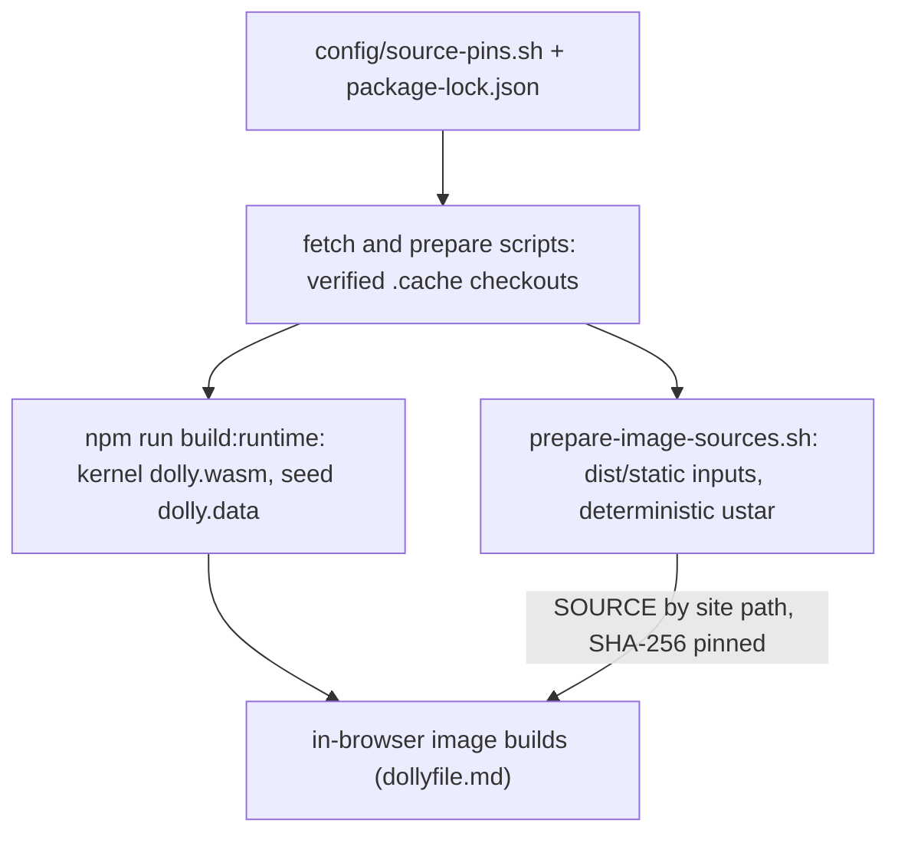

# Sources and bootstrap

Outside the browser, an external toolchain builds only the kernel and the
seed's libc and bootstrap. Every ordinary program, the seed's compiler among them, is compiled
inside Dolly from pinned source during an image build. This page lists the
bootstrap exceptions, how inputs are pinned, and what the core ports support.

## Bootstrap exceptions

| Component | Built outside Dolly | Result |
| --- | --- | --- |
| Emscripten 6.0.8 | Digest-pinned container links the kernel, process sysroot, gate and seed ([`CMakeLists.txt`](../toolchain/CMakeLists.txt), [`build.sh`](../scripts/build.sh)) | Kernel plus process libc with its compiler-rt builtins, which the first link needs; the seed holds headers and the Dollyfile engine source, which [`bootstrap.c`](../src/process/bootstrap.c) compiles before the first recipe |

libc++, libc++abi and libunwind are not among them: [`Dollyfile-system-build`](../Dollyfile-system-build)
compiles Emscripten's pinned copy with the flags of Emscripten's own build,
before the first C++ program. The container's build of them names what an
`-rdynamic` host exports ([`prepare-process-sysroot.sh`](../scripts/prepare-process-sysroot.sh)).

The libc's and libc++'s headers, and libc++'s sources, are staged with their
`__EMSCRIPTEN__` tests renamed to `__dolly__`, and LLVM generates code under the
libc's triple, `wasm64-unknown-emscripten`; a program sees neither name
([process model](process-model.md#executables)).

Demo exceptions (the Rust compiler seed) are recorded in their demo READMEs.
Every externally built program (the Rust seed)
validates against `dolly-process-0` exactly and ships without an Emscripten
JavaScript loader. Host preparation may
configure and patch pinned trees deterministically and reviewably, but must not
compile the programs an image claims to build.

## The seed's compiler

`cc`, `c++`, `ld` and `ar` spawn one executable, Clang and LLD of LLVM 24 with
Dolly's driver ([`compiler.cpp`](../src/compiler.cpp)), as a private process.
It is built inside Dolly by the previous seed's compiler: the `llvm` demo's
images compile LLVM from `DOLLY_LLVM_COMMIT` (`llvm-tablegen`, `llvm-build`)
and link the compiler without its names (`llvm-cc`).
`demos/llvm/pin-seed-compiler.mjs` puts that compiler and Clang's resource
headers, as `llvm-build` generated them, at their seed paths in one archive,
pinned in [`source-pins.sh`](../config/source-pins.sh) (`DOLLY_SEED_COMPILER_*`).
[`build.sh`](../scripts/build.sh) takes the archive by that SHA-256 alone and
checks the compiler against `dolly-process-0`.

- The recipes are the one part of the core's bootstrap that lives in a demo:
  `llvm-tablegen` configures LLVM with CMake and Python, which are demos too.
  Nothing of the core reads them; it reads the pin alone.
- A checkout without the archive downloads it from the GitHub release that
  carries it: every release uploads the seed compiler it was built with.
- Changing the compiler (its driver, the LLVM pin, the libc it links) takes a
  round: build `llvm-cc` with the current seed, pin it, rebuild the runtime and
  the catalog. `llvm-cc` built by the new seed gives the pinned bytes again, or
  is pinned for another round.
- The compiler writes the digests of `dolly-process-0` and
  `dolly-kernel-plugin-0` into what it links. A new kernel plugin contract is
  such a round. A new process contract is not yet: the compiler for it, built
  under the old runtime, would have to link itself once more to run under the
  new one, and no recipe does that.
- The first compiler built inside Dolly was linked by a seed whose compiler
  was a host build of the same sources and driver (`scripts/build-toolchain.sh`,
  last in commit `3fc9d5da`); a bootstrap from nothing starts there.

## Pins and identity

- Upstream versions, URLs and archive digests live in
  [`source-pins.sh`](../config/source-pins.sh) and the npm lockfile. Dollyfiles
  pin the exact served bytes, since preparation can change bytes without changing
  upstream.
- [`prepare-image-sources.sh`](../scripts/prepare-image-sources.sh) stages the
  selected catalog's inputs (each demo adds a `prepare-sources.sh` hook);
  [`generate-routes.mjs`](../scripts/generate-routes.mjs) checks every
  site-path `SOURCE` row against its bytes. Only those rows and module texts are
  trusted build inputs; adding one means referencing it from a recipe.
- [`build-source-tar.mjs`](../scripts/build-source-tar.mjs) writes deterministic
  ustar archives (regular files only, fixed metadata, no host paths). The in-Dolly
  `/bin/tar` ([`Dollyfile-system-build`](../Dollyfile-system-build)) extracts only regular files and
  directories inside WasmFS.
- [`write-build-id.mjs`](../scripts/write-build-id.mjs) derives two identities.
  The image build ID covers the seed, its loader and the process, `dso@0`,
  kernel-plugin and snapshot contracts; images and caches use it, so kernel-only
  changes reuse images. The runtime build ID adds the kernel bytes; sessions
  require it.
- Preparation writes to unique staging paths and publishes completed,
  verified results atomically.

## Core ports

| Family | Support | Limits |
| --- | --- | --- |
| Slop, sbase, Dolly commands | Shell scripts and POSIX file/text tools ([Slop](slop.md)) | Not Bash; POSIX flags, not GNU |
| C/C++ | Clang/LLD, archives, libc++, process-local DSOs with `dso@0`, `-pthread` with `threads@0` | No native target, `fork` or `exec` |
| Make, Ninja | GNU Make 4.4.1 and Samurai 1.3 | Ninja runs one job |
| Git, curl | Local Git 2.55 and HTTP clone/fetch/push over Fetch-backed libcurl ([HTTP](http.md)) | CORS applies; no sockets; clean/smudge filters unported |
| Awk, zlib, gzip | One True Awk (Bison output prepared outside), zlib 1.3.2, Dolly `gzip` | |
| less | less 692 over GNU termcap 1.3.1, from upstream's archives; the recipe states what `configure` would find | No later less: from 701 on it asks termcap for a key before `tgetent` when its output is not a terminal, which termcap 1.3.1 does not survive |
| Zig, Ghostty | Zig 0.16 built from source by `cc`; source-built terminal ([display](display.md#zig-and-the-ghostty-build)) | Builder images only; Zig emits only C |

Everything above Dolly's core (Python, JavaScript and Pi, Neovim, Rust, games) is
a demo under `demos/`, listed in `demos/README.md`.

## Reproducibility

`npm run image -- system-build --reproducible` compares two cold browser builds and
a cached build. With the pinned toolchain and browser, compiler scratch files are
named by their output path and LLD section merging is fixed, so the snapshots
match. Cross-browser bit reproducibility is not claimed; every input byte is
still pinned and verified.
